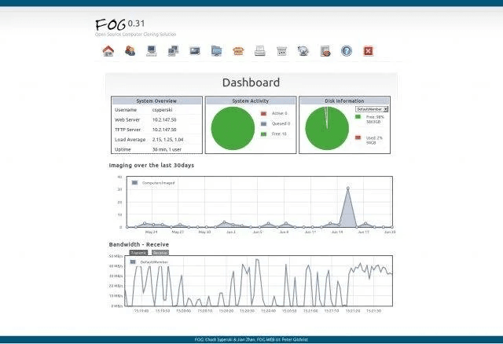

If you manage a large number of Windows PCs you will want a way to set them up as quickly and painlessly as possible.

There are many system imaging solutions out there (such as Symantec Ghost, Altiris etc) but these tend to be expensive. Working in education you learn quickly to find cheap or free solutions or even make one yourself. Imaging software can be complex, especially dealing with boot sectors and partition maps so I think I will leave that one with the experts!

We used to use Symantec Ghost back when it came on floppies and was called Norton Ghost. Once the version we had stopped being useful we had to find a solution.

Initially I built a custom WinPE CD with some custom scripts to run the Microsoft ImageX tool to make WIM system images. This worked very well, with a custom menu system to make selecting images simple and reduce the possibility of over-writing a previous image with a faulty one.

While it worked, there were a few issues with imaging machines and getting the boot flags set correctly on the drive afterwards, and the WinPE disc wouldn’t recognise the network card on some machines.

So we eventually moved over to using The FOG Project.

FOG is a free open source imaging system. It runs on Linux and comprises a PXE server, small PXE boot image and a Web GUI and database backend. It allows you to network boot a machine, take an image of it and save to the server. You can then auto boot a whole set of machines and push that image out to them.

It also has a client app that runs on Windows that will automatically rename workstations based on their info in the FOG database. It can additionally make the machines join your domain and adjust settings such as screen resolution, attached printers and even push out software packages.

It really is a great package, with a great Web UI update in the recent 1.2 version. They are working hard on a new release with the client app being rewritten from the ground up to give new features and efficiencies.

If you manage a lot of machines, especially if you have labs or rooms of similar machines, you really need an imaging solution and if you are on a budget, FOG is an excellent solution.

Read more about it and download it from [the FOG Project website](https://www.fogproject.org).
