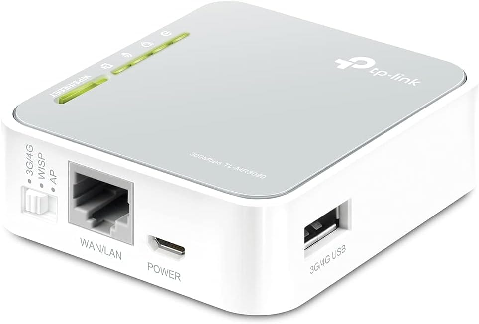

A travel router has been an item on my “to buy” list for some and I am now on a 5 day holiday to England so took this as the impetus to go ahead and buy one. So I bought the [TP-Link TL-MR3020 Travel Router from Amazon](http://www.amazon.co.uk/gp/product/B00634PLTW/ref=as_li_tl?ie=UTF8&camp=1634&creative=19450&creativeASIN=B00634PLTW&linkCode=as2&tag=th0e-21&linkId=UCNS364EVO2GDUA6).

### What is a travel router and why would you want one?

A travel router is much like your BT HomeHub or similar router at home. It allows multiple wireless devices to connect to it to get internet access.

In hotels they tend to have wireless networks now. Why wouldn’t you just connect directly? The hotels will usually give free WiFi to a limit and then charge if you want the good stuff. But when you pay for the “premium” WiFi service, you are paying for a single device. That means you would have to typically pay for your phone and then again for an iPad, a third time for your laptop etc.

By using the travel router as the device you are registering with the system, you can connect it to the hotel WiFi and then your devices connect to the travel router. This makes all of your devices appear like a single device, thereby only requiring a single purchase!

### So, is it any good and does it work?

Yes it works. I am currently typing this post on my laptop whilst my wife is using her iPhone and my in-laws in the next room are also connected on their phones and iPads and all under a single payment.

Also when I set the device up, I set up the personal wireless section of it with the same settings and names as our wireless at home. This means my family don’t have to do anything to make it work, their devices just think they are at our house and work as normal!

And the best part is this little box of tricks is tiny , powered by USB and only costs around £25.

### What else can it do?

I am just using the device to connect to hotel WiFi. You can also plug in a 3G/4G dongle and share the connection from it to all your devices. This isn’t so useful to me personally as we have iPhones and they can do this via the Personal Hotspot feature.

It can also act as a repeater if you just need to just boost a weak wireless signal in your house.

I am amazed that you can do all of this with such an inexpensive and small device.

It really should be in every travelling geeks toolkit.
