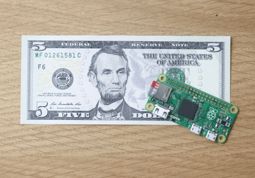

This really is an amazing time to be a geek.

The awesome Raspberry Pi Foundation continue to amaze. They have just released a new model of Raspberry Pi - the Pi Zero. It is only £4 / $5 to buy! If that isn’t enough to completely blow your mind, they are giving them away free on the front of this months MagPi magazine (available in Tesco, WH Smiths etc).

A computer. Free on the front of a magazine. Just think about that.

My first PC had a 100Mhz CPU with 32MB of RAM and cost around £1000. This has a 1Ghz CPU (10 times more) and 512MB of RAM and costs £4. (I know the Ghz / Mhz comparison is flawed due to ARM vs Intel etc. but don’t spoil the moment, it’s still cool!)

The Pi Zero uses the same BM2835 CPU as the original Raspberry Pi but has been overclocked to produce about 40% extra speed. It has also received a bump in memory to 512MB.

## Raspberry Pi Zero: The Specs:

- A Broadcom BCM2835 application processor
    
    - 1GHz ARM11 core (40% faster than Raspberry Pi 1)

- 512MB of LPDDR2 SDRAM
    

- A micro-SD card slot
    

- A mini-HDMI socket for 1080p60 video output
    

- Micro-USB sockets for data and power
    

- An unpopulated 40-pin GPIO header
    
    - Identical pinout to Model A+/B+/2B

- An unpopulated composite video header
    

- An unpopulated reset switch header
    

- Our smallest ever form factor, at 65mm x 30mm x 5mm
    
      
    

Don’t think about it, just go on to [The Pi Hut](http://thepihut.com/products/raspberry-pi-zero) or [Pimoroni](http://pimoroni.com/zero) and get some ordered. If you have chidlren who you would like to introduce to coding and electronics, one of these with a few cables would make a fantastic stocking filler. It will run Scratch, Sonic Pi, and all the other fantastic tools that have been provided to aid budding coders in the latest release of Raspbian.

I can see this new small form factor enabling some wearable tech using a Pi, or very small embedded systems. And the insanely low cost will hopefully remove the final barrier for anyone wanting to learn more about computers and coding. What a noble goal the Raspberry Pi foundaton have been aiming for and I think they have totally smashed it. To be able to put a computer to play and experiment and learn on within reach of anyone in society. Amazing.

Happy geeking!
