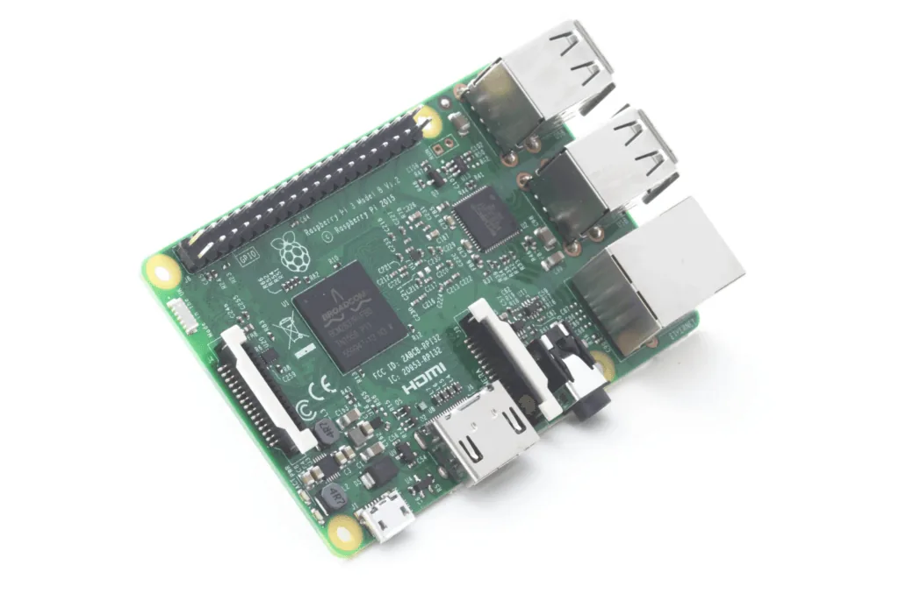

The [Raspberry Pi Foundation](https://www.raspberrypi.org/) have just celebrated their 4th birthday today (although due to leap year technicalities they are claiming it is only their 1st birthday!). And what better way to celebrate than with the release of a fresh new Raspberry Pi!

## What is a Raspberry Pi?

The Raspberry Pi is a low cost credit card sized computer. This style of computer has become much more prominent since the foundation released the first model back in 2012.

More companies are springing up offering these “single board computers” but none have achieved the same traction and community engagement as the Raspberry Pi. Over 8 million computers have been sold so far making them the most successful British computer manufacturer ever!

The Raspberry Pi allows connection of electronics such as sensors and motors to enable a wide range of projects to be dreamed up. Hobbyists and tinkerers love devices like this, and with each iteration it just gets better and better.

It was designed with the main goal of making computers for tinkering affordable so that every child could have one to help solve a programming skills shortage in UK universites, and at £30 it is certainly affordable. They also sell a [Raspberry Pi Zero](/raspberry-pi-zero-a-computer-for-only-4/) computer for just £5.

## So what’s new?

The Raspberry Pi 3 Model B is 10x faster than the original Pi, and is between 50 - 60% faster than the Pi 2. It also comes with built in WiFi and Bluetooth (standard and LE). The addition of WiFi and Bluetooth is a major advantage and has been a long requested feature. This will allow connection to the Internet out of the box and the use of wireless keyboards and mice without using up those precious USB ports.

The board is the same shape and size as the previous models which means all the old accessories and addons should work without modification.

Mine is ordered from the excellent [Pi Hut](https://thepihut.com/) and should be here tomorrow! They also sell a brilliant [starter kit on Amazon](https://www.amazon.co.uk/gp/product/B01CCJJR0K/ref=as_li_tl?ie=UTF8&camp=1634&creative=19450&creativeASIN=B01CCJJR0K&linkCode=as2&tag=th0e-21) with everything you need to get started.
