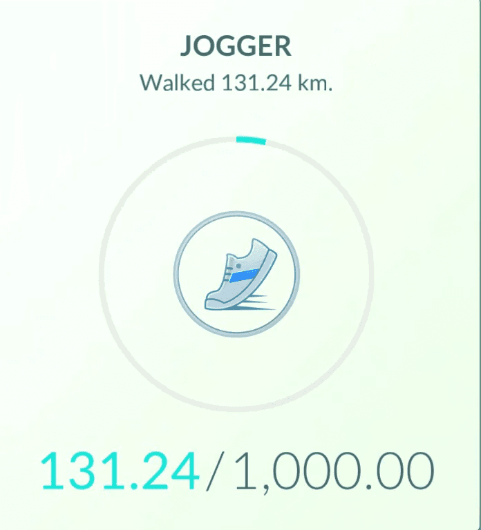
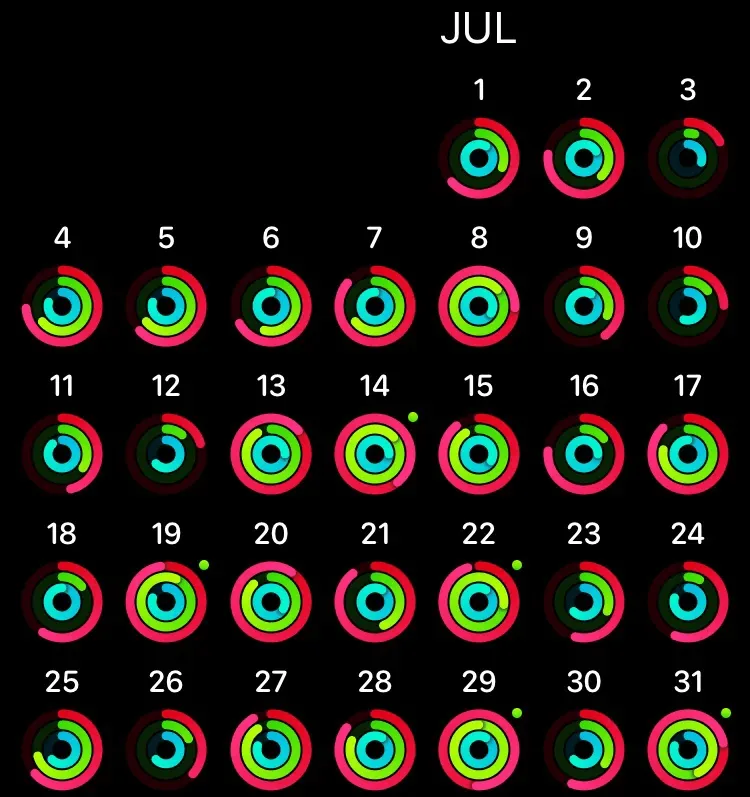
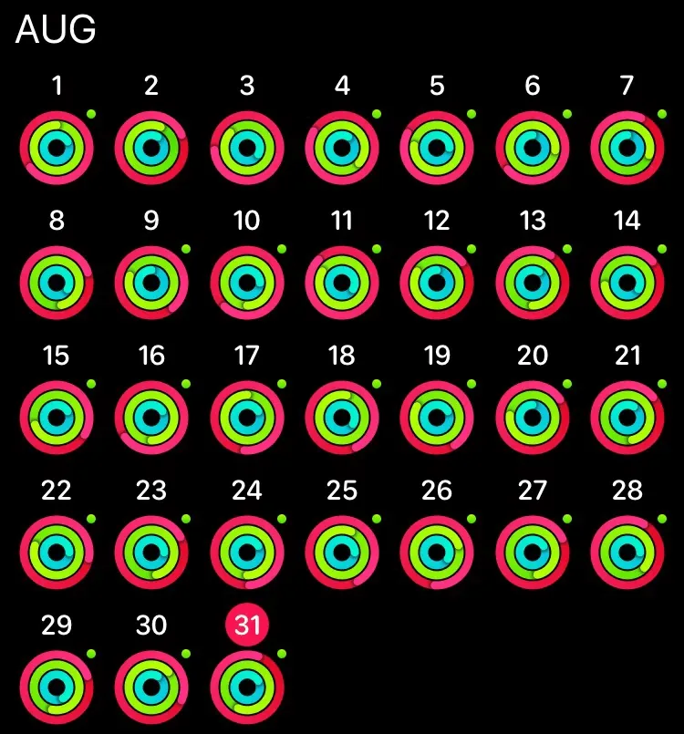
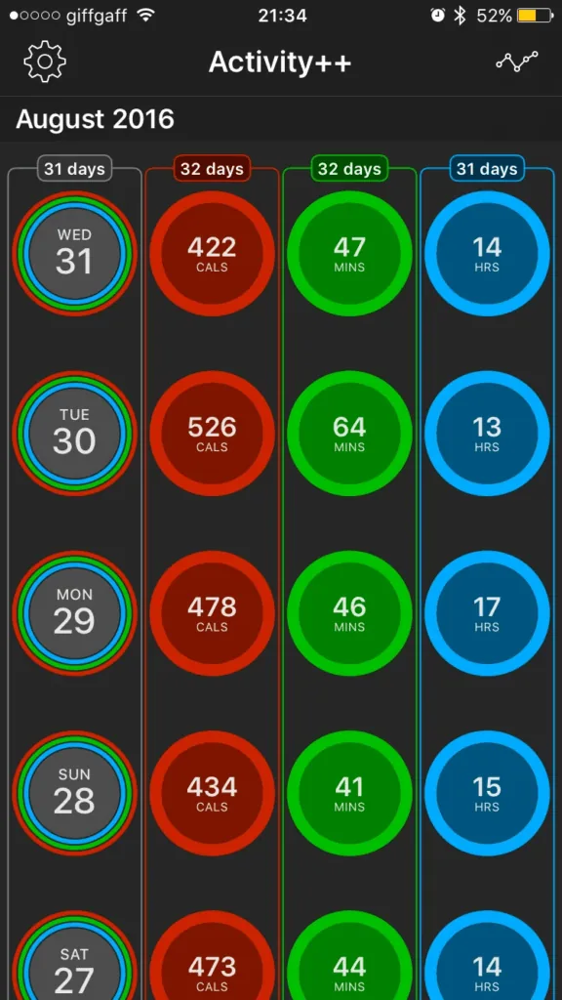
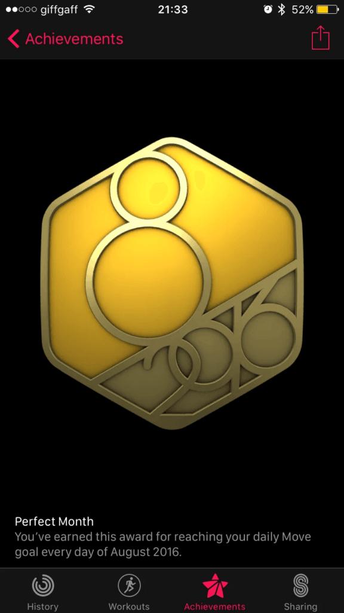

So I have a dark secret….. I play [Pokemon Go](https://geo.itunes.apple.com/gb/app/pokemon-go/id1094591345?mt=8&uo=4&at=1010l6dq). It is a part of the reason things have been so quiet on here.

I just missed the original Pokemon craze as a player, but I worked in Game at the time so was exposed to the mania of it on a daily basis.

> “Hey Mr, you got any Pokemon cards in stock?”

When I read about the upcoming game and saw [some of the trailers](https://m.youtube.com/watch?v=2sj2iQyBTQs) I was intrigued. The urban exploration and social aspects of the game looked fascinating and, thanks to having a severe Warcraft addiction, any game that involves levelling up and collection of items towards achievements I am a sucker for.

I have also been wanting to shift some extra weight and exercise more to help clear my head, so Pokemon Go seemed like a potentially good fit. If nothing else it was a free game that would provide a few days of novelty. This is how it started.

I think I downloaded the game on the UK release day mid-July, but the hype meant that getting logged onto the servers was practically impossible. After a week or so I started playing properly. As I slowly got more interested I started going out for quick walks here and there to stock up on Pokeballs from the various Pokestops. I soon realised that this could be a useful trigger to get me out walking every night so I increased my daily Move goal limit on the watch from the 1st of August.

As I discovered more to the game I realised that you could incubate eggs that you collect. They come in 2km, 5km and 10km varieties and you place them into an incubator and then have to walk with the game running to hatch them. Most evenings I was going out for a 4-5km walk. There aren’t many Pokemon round my house so hatching was my best option, and also meant more walking and fitness! I hadn’t realised just how much I was doing until I got a distance achievement in the game. Yeh, in August (only counting time the game was active, so none of my daily walking in work) I walked over 130km.

Pro Tip: Pokemon Go eats battery. I recommend getting a portable battery charger pack like the [Anker Powercore 10000](https://amzn.to/2bRf5js). A smaller one would also work but this one is capable of charging iPads and can be used with Raspberry Pi for portable projects.

The results speak for themselves. Here are my Apple Activity month charts for July and August.

The combination of wanting to get out and “catch ’em all” and maintain my streaks in Activity++ (now discontinued) lead me to The Perfect Month. Hitting all 3 activity goals every day of a month. And I feel better for it. I find I can concentrate better and my anxiety has been kept at bay like it hasn’t in years.

I have always academically known the benefits of walking etc but getting the ball rolling can be tough, it is too easy to get home from a long day and just sit in front of the computer and waste your night. Initially Pokemon Go gave me the nudge to get out, augmented by Activity++ and its congratulatory confetti shower every time I hit my goals. And now I feel better and have my Perfect Month badge to show for it!

But, you know, all video games are bad for you…..
