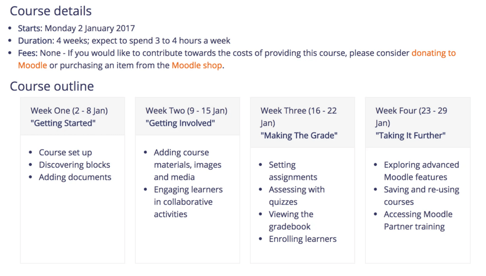

If you are a beginner to the [Moodle Learning Management System](http://www.moodle.org) or even a current user just wishing to update and hone their skills then I can highly recommend this free online course delivered by the Moodle team themselves.

The course will take you through the basics of using Moodle to deliver Learning and Teaching to your students and showcases some of the excellent widgets and tools on offer.

And because the course is run on Moodle itself, you get to experience the learning as a student would on your course. I found this perspective really helped spark some ideas for ways to deliver content to make it more fun and engaging.

[You can sign up here](https://learn.moodle.net/login/signup.php) but as there are peer assessed sections you need get signed up this week to make sure you don’t miss any deadlines. They run these courses approximately every 6 months.

The course is free and should only require 3-4 hours per week of time (probably less if you have used Moodle before). The community engagement aspect will also allow you to see how Moodle is used in a variety of learning environments and you will leave enthused and bursting with ideas!

Here is a copy of the course outline. You also get a digital certificate on completion of the course, which you may be able to use towards whatever form of Professional Development scheme your institution operates.

