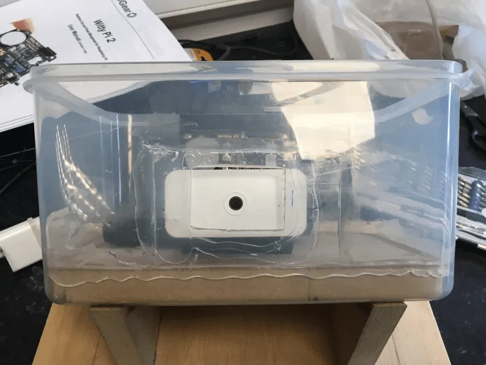
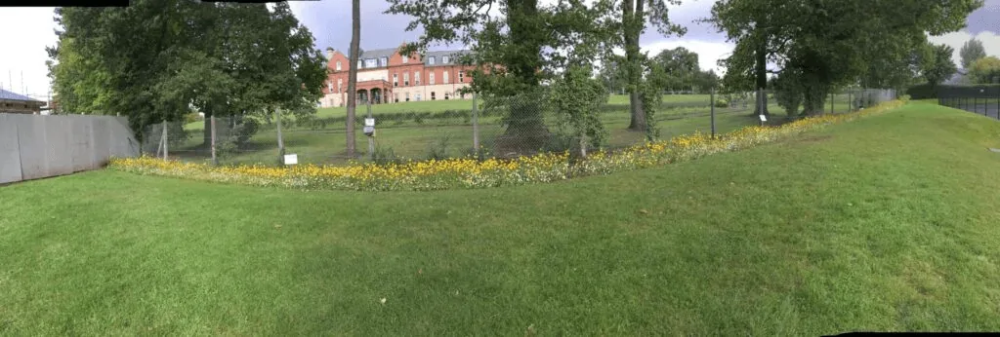
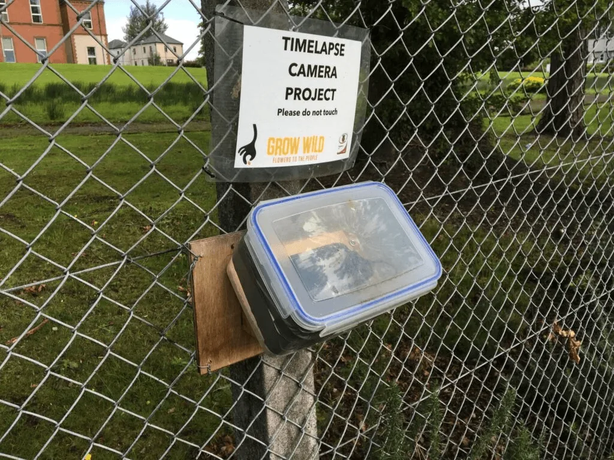
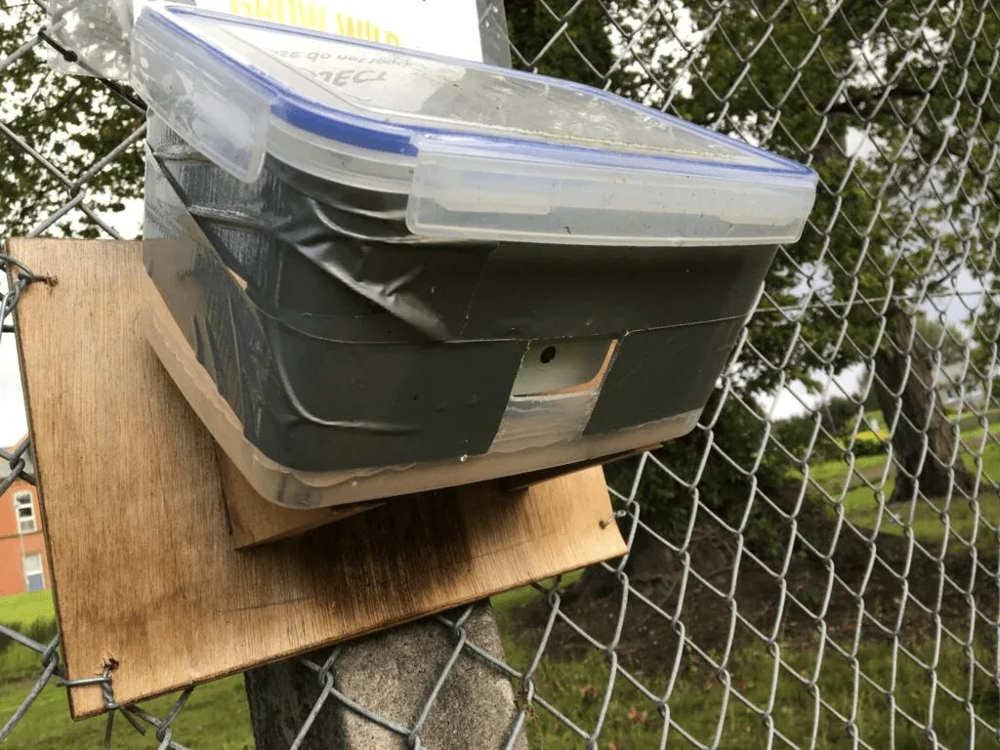
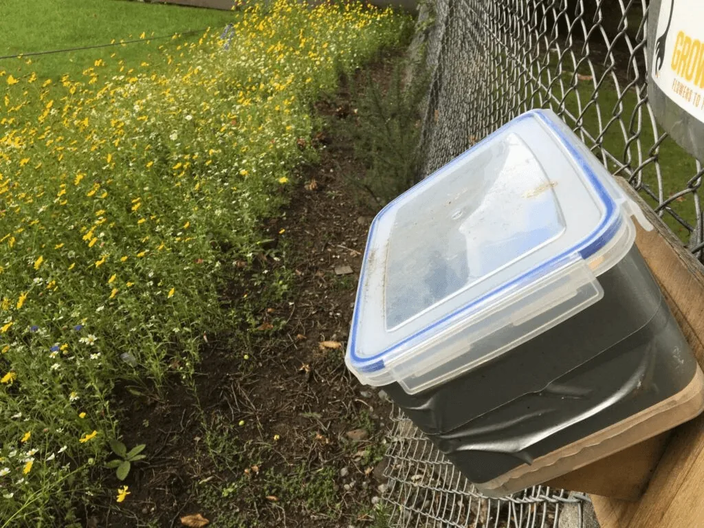
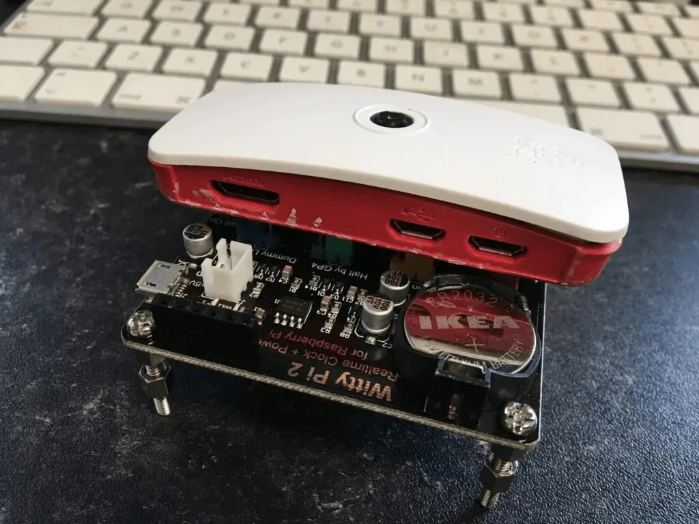
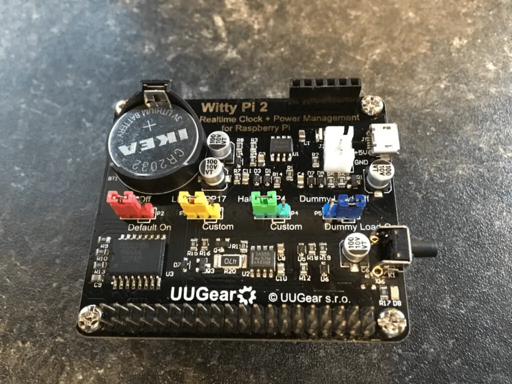
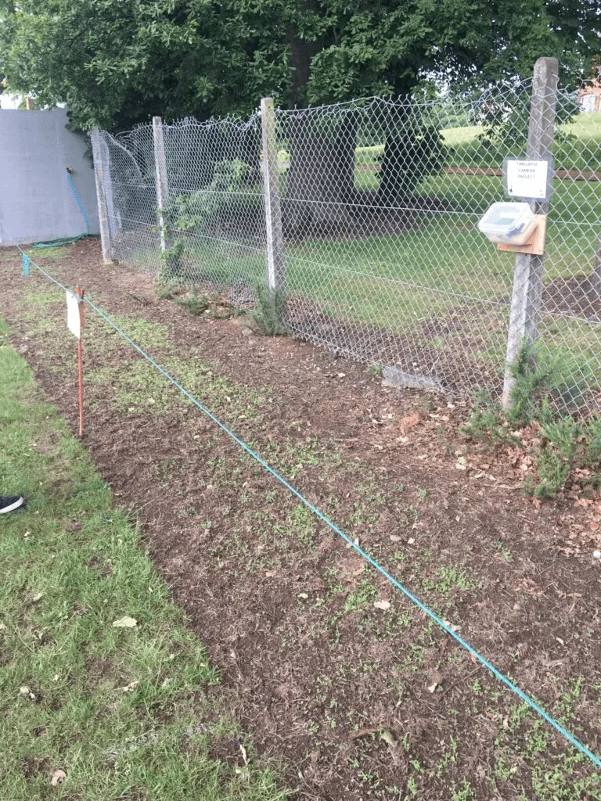
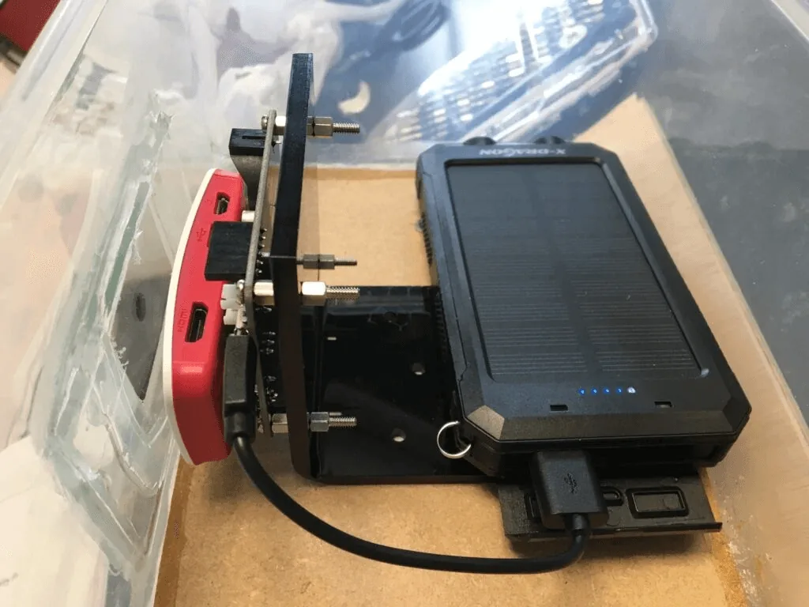

This year our school Eco Club began a project to plant a wild flower area in the school grounds. This was part of the Grow Wild scheme run in association with Kew Gardens.

https://vimeo.com/336299882

I am not much of a gardener so my attention was turned to the techy side. The team wanted a time-lapse video to be created of the area for a period of a few months to capture the growth of the flowers and plants. Time to build a Raspberry Pi Time-lapse box!

Where the camera had to be placed to capture the flowers was going to rule out having a power source. We looked at running an ethernet cable and using power over ethernet but we would have had to do some fairly serious digging and it seemed like too much of an undertaking. Battery power was the plan so I had to make something reasonably power efficient. We settled on the following parts:

- [Raspberry Pi Zero W with official case with camera lid](https://amzn.to/2jPjsTc)
    

- [Raspberry Pi Zero Camera Module](https://amzn.to/2hobOuM)
    

- [WittyPi2 Power Control board and RealTime Clock](https://www.uugear.com/product/wittypi2/)
    

- [USB Battery Bank with Solar panel](https://amzn.to/2fht8AQ)
    

- Old Tupperware box
    

([a Zero friendly version of the WittyPi has just been released!](https://thepihut.com/products/wittypi-mini-rtc-power-management-for-raspberry-pi))

We cut a hole in the Tupperware box as it had a slight frosting which would affect the image quality. A small piece of glass from a picture frame was attached with silicone to provide a viewing window for the camera. A few days in we realised the rig wasnt coping well with bright sunlight so we taped around with gaffer tape to reduce glare into the lens.



















Thanks to Sid in our Technology and Design Dept we got a plastic bracket made up to hold the Raspberry Pi in place and it was bolted to the box by some pieces of wood by Colin our Maintenance officer and a bracket made to angle the box and mount it to a fence post.

The Pi was put into the official case with the camera mount and stacked on top of the Witty Pi 2 power control board. This board acts as a timer to allow wake up and shutdown of the Pi on a schedule. The first board we received turned out to have a problem but the guys at UUGear very quickly identified that it was a hardware issue and the amazing Ryan at RyanTek sent us a replacement board in record time!

Powered by the battery bank, the hope was that the solar charging part would be enough to keep it all running indefinitely. That didn’t quite pan out! The battery pack would last for around 8 days so we just switched it every week with a smaller one while it recharged and then swapped back again. The lid of the Tupperware made for easy access to do the battery swaps.

We set the WittyPi scripts to turn the Pi on every hour from 8am to 8pm and shut down again after 2 minutes. This allowed time for a script to run to take a photo, send a push notification and upload a copy of the photo to a server on our internal network (in case of theft). The shutdown command had a 60 sec delay (this would allow a brief window to SSH in and cancel a shutdown if you needed to carry out any maintenance). Sometimes the shutdown command wouldn’t fire so I added a second one in the crontab to make sure it would shutdown to preserve the battery.

One of the great things about working in education is that you get all kinds of weird and wonderful requests for projects like these, makes the job fun and challenging!

**Crontab**

```
\* \* \* \* sudo /sbin/shutdown -h +1 "Backup poweroff in 60 seconds" 
```

**/etc/rc.local (add this to the end)**

```
sh /home/pi/startup.sh &amp;
```

**startup.sh**

```
#!/bin/bash 
SCRIPT_LOG=/home/pi/time.log 
writeLog() { 
TIMEANDDATE=$(date)
echo "[$TIMEANDDATE] - $1" >> $SCRIPT_LOG 
} 
writeLog "Sleeping 10s for network" 
sleep 10s 
CURRDATE="" 
CURRDATE=$(date +"%Y-%m-%d\_%H%M") 
MYIP=$(ifconfig | grep -A 1 'wlan0' | tail -1 | cut -d ':' -f 2 | cut -d ' ' -f 1) 
writeLog "Taking photo" 
raspistill -rot 270 -n -awb auto -o /home/pi/photos/$CURRDATE.jpg 
writeLog "Photo taken" 
writeLog "Uploading photo" 
curl -m 60 -X POST -F 'fileToUpload=@/home/pi/photos/'$CURRDATE.jpg https://ourinternalserver/uploader.php >/dev/null 2>&1 
writeLog "Sending notification" 
curl -m 10 --data-urlencode "value1=Startup" --data-urlencode "value2=https://ourinternalserver/timelapse/$CURRDATE-LOW.jpg"; --data-urlencode "value3=https://ourinternalserver/timelapse/$CURRDATE.jpg"; http://maker.ifttt.com/trigger/grow_wild_photo/with/key/ouriftttkey >/dev/null 2>&1 
writeLog "Finished startup.sh"
```
