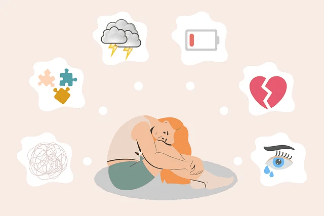

This CoronaVirus outbreak is understandably difficult for everyone. Many people will be struggling with their mental health, including “normal” people who have not had issues before. I hope that sharing what little I know from my personal experience might help even one person.

I have issues with mental health, specifically a fairly aggressive anxiety disorder, panic attacks and a form of OCD (OCD of thoughts, thankfully I do not have any of the rituals that come with the more severe kind).

During times like this my tendency towards negative thinking can become overwhelming. In Cognitive Behavioural Therapy they are described as Automatic Negative Thoughts. There are many categories of them and they fall into groups like All or Nothing thinking, Catastrophising ( I am awesome at this one! And also know it isn’t a real word… ), Mind Reading (thinking you know what horrible things other MUST be thinking about you, like “his spelling is awful, Catastrophising isn’t even a real word”) etc.

Almost all of these ANTs are based on false beliefs, cognitive biases and assumptions.

I have [found this worksheet](https://www.getselfhelp.co.uk/docs/ThoughtRecordSheet7.pdf) incredibly useful to help defuse these thoughts and over time reduce their frequency. It can seem silly at first but if you stick at it you will feel noticeably better after writing out the thought and seeing it for what it is. Just a thought.

I would recommend writing on the sheet using an Apple Pencil or with pen and paper. There is something about the act of writing that works better than typing. But typing is still better than not doing it at all.

## Mindfulness for mental health

[Mindfulness](https://www.nhs.uk/conditions/stress-anxiety-depression/mindfulness/) practice is something I also thought was a bit hippy dippy but now I see the benefits. It has also been proven to be beneficial for pretty much everyones health, but specifically for anxiety and depression. Even just a few minutes to focus on the present moment and nothing else can quickly quash a build up of negativity.

For this you can use any of the following:

- 
    
    Breathe app on Apple Watch
    
      
    

- 
    
    [Smiling Mind](https://www.smilingmind.com.au) (iOS, Android)
    
      
    

- 
    
    [Stop, Breathe and Think](https://www.stopbreathethink.com) (iOS, Android)
    
      
    

- 
    
    [Headspace](https://www.headspace.com/)
    
      
    

Most of these are free, or have free content to get started with. Headspace has some basic free content that is worth trying, but the full app is also free for educators in UK, US, Canada and Australia. You can apply for a [free full account here](https://www.headspace.com/educators) 

## Social Media and News Diet

This one is tricky. Social media can provide a lot of fun, humour and welcome distraction. It can also provide connection to people to help with loneliness. However it also comes with a ton of fake news and FUD (Fear, Uncertainty and Doubt).

I would stick to fun social media outlets like Instagram. Facebook can become a mental health drain very quickly.

Also watch the news once a day and don’t keep checking. Turn off breaking news notifications in any news apps you have. If something important happens, don’t worry, you will hear about it.

## Exercise for mental health

I am not great at following this one myself, but getting some exercise and specifically getting out into nature can be immensely rewarding. Get out for a walk and really take in what you see. Make it an exercise in mindfulness and noticing the sights and smells and sounds. A walk on a sunny day in a park is hard to beat!

## Talk

I hope some of this is helpful. But if you are struggling then please please talk to someone about how you feel. A friend, colleague, even find a support group online. Just try to get it out there and you will be amazed how many “sane” people are thinking the same way you are! Bottling it up helps no one.

Stay safe.
