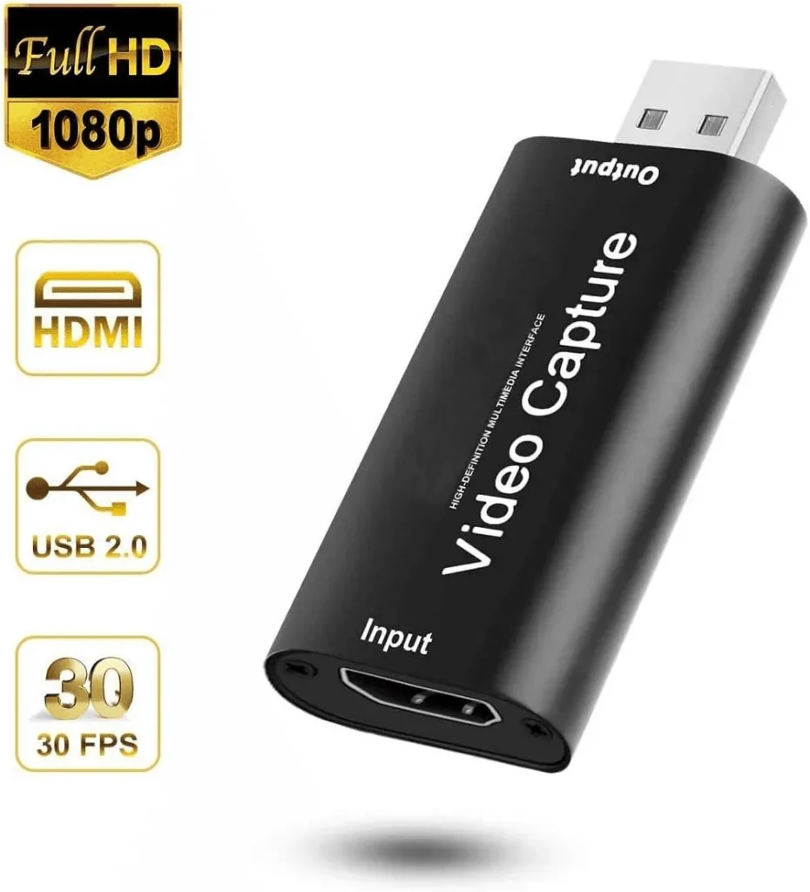

Been toying with the idea of making a few YouTube videos on setting up various Raspberry Pi things and thought that just pointing a camera at the monitor would look a bit rubbish.

I had always thought that HDMI capture devices would be crazy expensive but it turns out they are very cheap now, around £20 will get a half decent one. [I got this one](https://amzn.to/2D8V6hJ) for £8!!!

If you are a serial tinkerer, having one of these is not just good for recording videos, but also means you dont need a monitor when setting up a Pi, or in the most recent case, an Amazon Fire Stick.

I needed to reset and update my [Fire Stick](https://amzn.to/3b5emcG) and didnt have a spare monitor or TV in my room. HDMI capture stick to the rescue. Now I can have a window showing the output from the Fire Stick on my Mac desktop. Super convenient.
