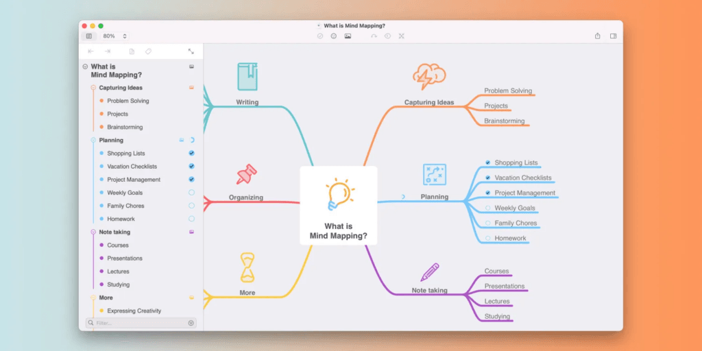
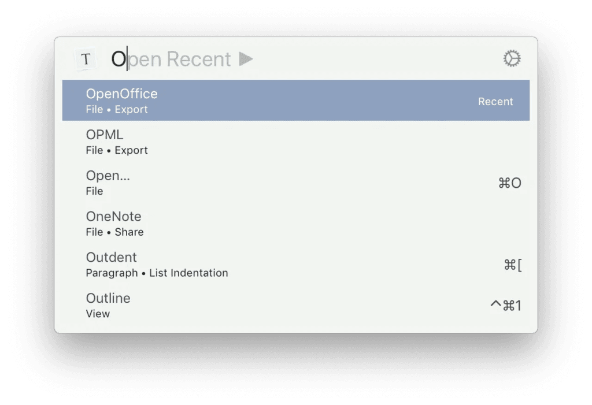
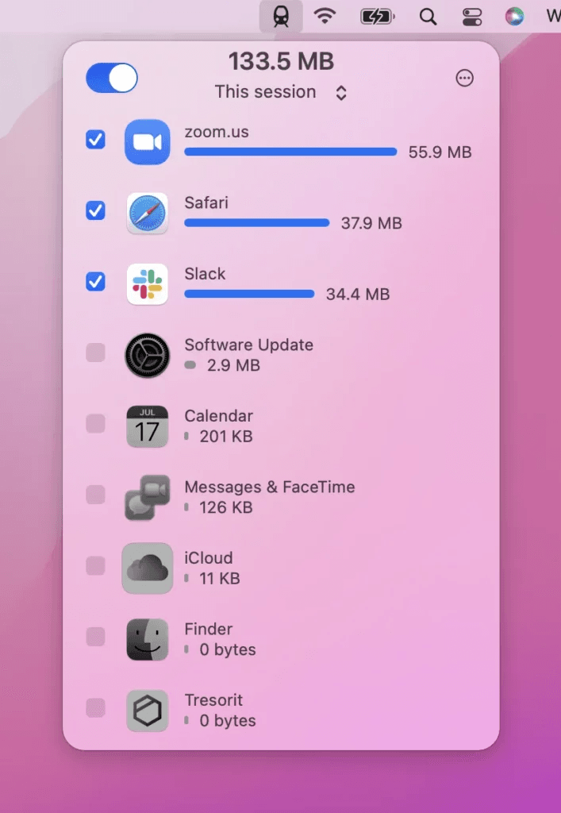

As a Mac user, I’ve discovered several Mac apps that have become indispensable in my daily routine. All of these apps are included in the Setapp subscription, [over 240 amazing apps for just $9.99 a month.](https://setapp.sjv.io/c/4159433/343321/5114)

### MindNode

Organizing thoughts and brainstorming ideas has never been more enjoyable than with [MindNode](https://www.mindnode.com/download). This powerful mind mapping app helps me visualize complex concepts, plan projects, and even outline articles like this one. The fluidity of MindNode’s interface makes it easy to connect ideas, add notes, and create a clear structure. It’s a fantastic tool for creative minds, students, and professionals looking to enhance their productivity and creativity. It also has a companion iOS version and they sync quickly and effortlessly via iCloud.

If you have never tried mind mapping before, I would also recommend you [read the book by the creator Tony Buzan](https://amzn.to/45pzcOL) or [read this article](https://blog.iqmatrix.com/how-to-mind-map) for a quick introduction on them. I find them so useful to get things out of my head to free up some mental bandwidth!

<figure>

<figcaption>

MindNode in action

</figcaption>

</figure>

### Paletro - command palette

[Paletro](https://appmakes.io/paletro) provides quick access to commands available in the menu of the app you are using. Just use hotkey combination Command-Shift-P to prompt the command menu for the app you are in, browse or search commands, locate the one you need, and click Enter to execute. The more time you can spend on the keyboard and not needing to use the mouse, the faster you will be. Soon it becomes second nature and when you use a Mac that doesn’t have it installed it feels broken! Definitely an essential Mac app.

### Downie - Youtube video downloader

In the era of multimedia content, having a reliable video downloader is a game-changer. Downie is my go-to app for effortlessly downloading videos from various websites. Whether I’m saving educational lectures, entertainment content, or online tutorials, Downie makes the process quick and hassle-free. This also pairs briliantly with [Permute from my last article](https://intelligentdithering.com/supercharge-your-mac-with-mac-apps-from-setapp/), for downloading YouTube videos and then converting them to MP3 only so that you can listen to them on the move.

### Folx - Download Manager

While internet speeds have increased and connections have become more reliable than ever, failed downloads of large files can be a real pain. [Folx](https://www.mac-downloader.com) comes to the rescue as an efficient download manager that helps me organize, prioritize, and monitor my downloads effortlessly. It seamlessly integrates with web browsers, offers download scheduling, and even supports torrent downloads. Any time I am downloading a large file (such as an ISO of a Linux distro, Windows ISO or even AI training models) I put it straight into Folx. It will typcially speed the download up by downloading many chunks simulataneously and handles broken connections with ease.

### TripMode - monitor internet use of Mac apps

When you’re on the go, managing your internet connection is crucial to avoid unexpected data charges. [TripMode](https://tripmode.ch) is a brilliant app that gives me granular control over which apps can access the internet while I’m tethered to my mobile hotspot or on a limited network. This not only helps me save data but also ensures that essential tasks get priority. TripMode is an essential companion for travelers, remote workers, or anyone conscious of their internet usage. We use a 4G router when on holiday at our caravan and having TripMode reassures me we aren’t going to burn through our allowance unexpectedly! Also provides a sometimes surprising view of just how many apps on your computer are using the network!

These are some of my favourite apps in the Setapp subscription bundle. But there are over 240 to choose from so you are bound to have some favourites I don’t know about. Please let us all know in the comments what Mac apps you have found.
