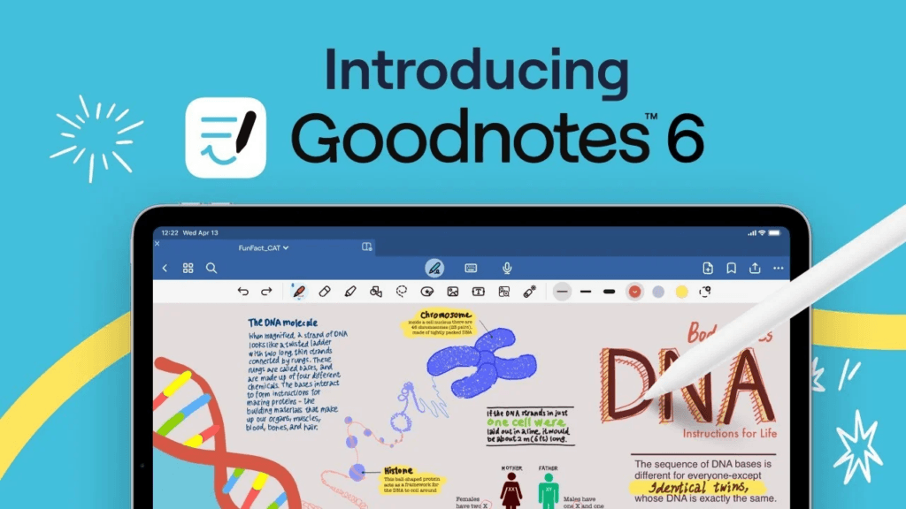

Goodnotes for iOS is an amazing app for note taking on iPad and has recently had a major update with impressive new features.

And if you are a school or other educational establishment you can apply to get it for free for all of your staff and students!

[This help article on the publishers site](https://support.goodnotes.com/hc/en-us/articles/7564248590223-Goodnotes-for-School-Educational-Licensing-Frequently-Asked-Questions) will give you details on how to apply. You will need to have an MDM (mobile device management) system managing your devices and access to the Apple Volume Purchase Program through Apple School Manager to deploy the licence key. [See my other article about ways to score free apps when they go on sale in the App Store!](https://intelligentdithering.com/getting-free-ipad-apps-for-education/)

The free version on the App Store only allows for up to 3 notebooks, which for student revision is probably not enough, so getting the Pro upgrade for free totally changes the game for your staff and students.

Goodnotes for iOS provides a modern and intuitive interface for taking notes on iPad and it really excels when paired with an Apple Pencil in particular. I use it daily for journalling my thoughts to keep on top of my mental health and this latest update is incredible. (I [talk a bit about my journaling process](https://intelligentdithering.com/lockdown-mental-health-1-year-later/) in this post about how I coped during the lockdowns)

Inserting custom paper types is a breeze, and you can purchase lots of pre-made PDF templates on sites like [Gumroad](https://gumroad.com) and [Etsy](https://www.etsy.com/uk/listing/1418676826/digital-planner-bundle-undated-planner?ga_order=most_relevant&ga_search_type=all&ga_view_type=gallery&ga_search_query=goodnotes+weekly+planner&ref=sc_gallery-1-1&bes=1&dd=1&plkey=5b49cd786729a01c34c4f3d07579274cb5fb5964%3A1418676826) to get exactly the look you want. Or you can design your own (I recommend doing this in Keynote, some [good video tutorials for this here)](https://www.youtube.com/watch?v=x2p5QuaRoW0). It is really useful for making up checklists or forms that you fill out on a regular basis but want to make the move to digital. You can even scan in a form you use and import it directly!

The recent update includes support for mathematical equations in handwriting. It also includes the mind-blowing feature of spelling correction IN YOUR HANDWRITING! If you misspell a word it will rewrite it in your own handwriting style. This is AI and machine learning at its best, especially if it is able to decipher my handwriting let alone recreate it! (although recreating chaos is probably easier than deciphering it and making it searchable).



It has all of the tools you would expect for a top tier digital note taking app like highlighters, chapter markings, table of contents, automatic search indexing (which makes searching your entire hand written corpus of notes a breeze, something that I would have loved when I was a student) and lots of shape types and diagramming tools. You can also easily drag and drop photos and images from the web or device camera so making a “revision scrapbook” or personal knowledge manager is simple, fast and fun.

Even if you are not a student I would highly recommend downloading the free version and having a go, it is really fun to play with and helps massively with creative thinking. There is something about getting things out of your head onto “paper” that frees the mind up like nothing else. Typing just doesn’t have the same feel.

And if you are school network admin with iPads to manage, you absolutely must get the Goodnotes for iOS free licences and enable this massive revision boost for your staff and students today!

If you have any cool uses or stories about how you use Goodnotes on your iPad, let us know in the comments section. It always amazes me how students use this app in new and creative ways that my brain just would never have come up with on it’s own.
