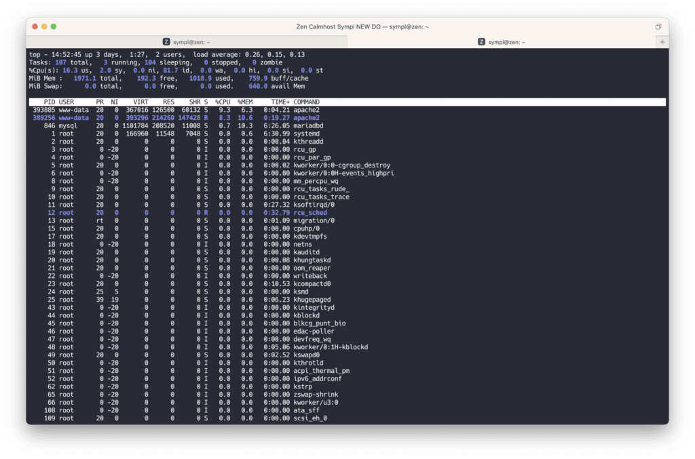
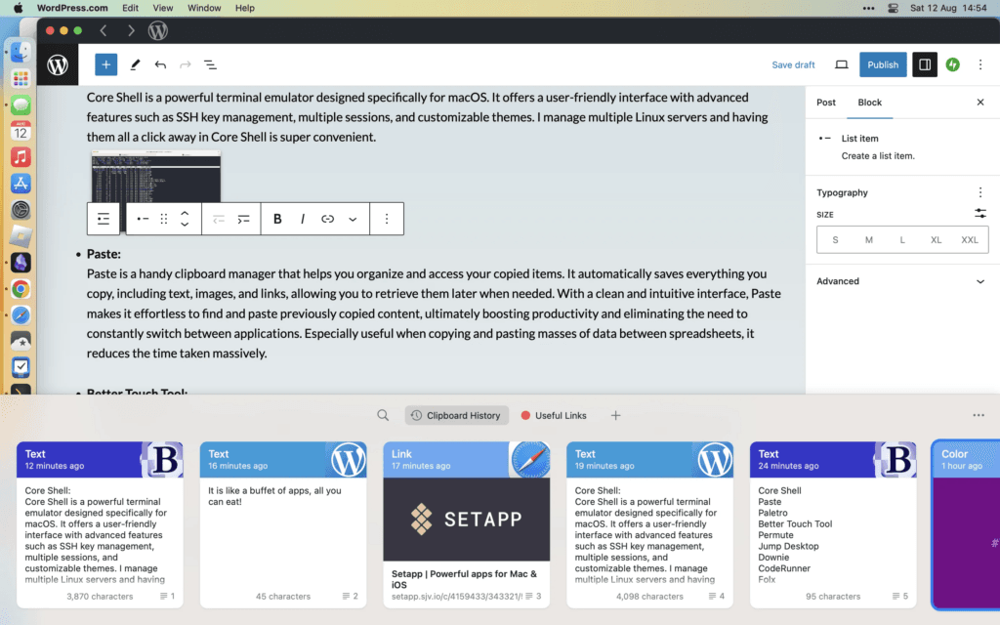

#### 5 Mac apps that I use every day (out of over 240!) for one low monthly price.

SetApp is a fantastic service for the Mac (and iOS) that gives you access to over 240 apps for a monthly subscription of only $9.99 a month. I have been using it for several years and even if you only use a handful of apps, it is sure to save you money. It is like a buffet of apps, all you can eat!

**[Sign up for a free trial NOW!](https://setapp.sjv.io/c/4159433/343321/5114)**

Anyway, here are five Mac apps that I use every day that I couldn’t live without.

### Core Shell

Core Shell is a powerful terminal emulator designed specifically for macOS. It offers a user-friendly interface with advanced features such as SSH key management, multiple sessions, and customizable themes. I manage multiple Linux servers and having them all a click away in Core Shell is super convenient. I also use this to manage our [DIY open source digital signage](/posts/2023/09/free-digital-signage-with-raspberry-pi-and-google-slides/) systems.  

### Paste

Paste is a handy clipboard manager that helps you organize and access your copied items. It automatically saves everything you copy, including text, images, and links, allowing you to retrieve them later when needed. With a clean and intuitive interface, Paste makes it effortless to find and paste previously copied content, ultimately boosting productivity and eliminating the need to constantly switch between applications. Especially useful when copying and pasting masses of data between spreadsheets, it reduces the time taken massively.

### Better Touch Tool

Better Touch Tool is a powerful Mac apps utility that enhances your productivity by enabling you to customize gestures, keyboard shortcuts, and mouse actions. With Better Touch Tool, you can create personalized shortcuts to launch applications, trigger specific commands, and control various system functions. It also has a great window snapping system built in which I use a lot.

### Permute

Permute is a media converter for macOS. It supports a wide range of audio and video formats and provides a straightforward interface for converting files with ease. Whether you need to convert a video file to a different format or extract audio from a video, Permute simplifies the process, allowing you to convert and export media files effortlessly. Drag a file in, choose the output format and hit go. It’s that simple!

### Jump Desktop

Jump Desktop is a remote desktop application that enables you to connect and access your computer or server. It supports various platforms, including macOS, Windows, iOS, and Android, providing a seamless remote access experience. Managing a fleet of Windows Server VMs from my Mac is a breeze with this app and it handles the mac -> windows keyboard issues (like the @ key being swapped with “) with ease. Highly recommended.

This is just a small selection of tools out of the 240+ that SetApp offers. I would say it is must buy for any serious Mac user!
