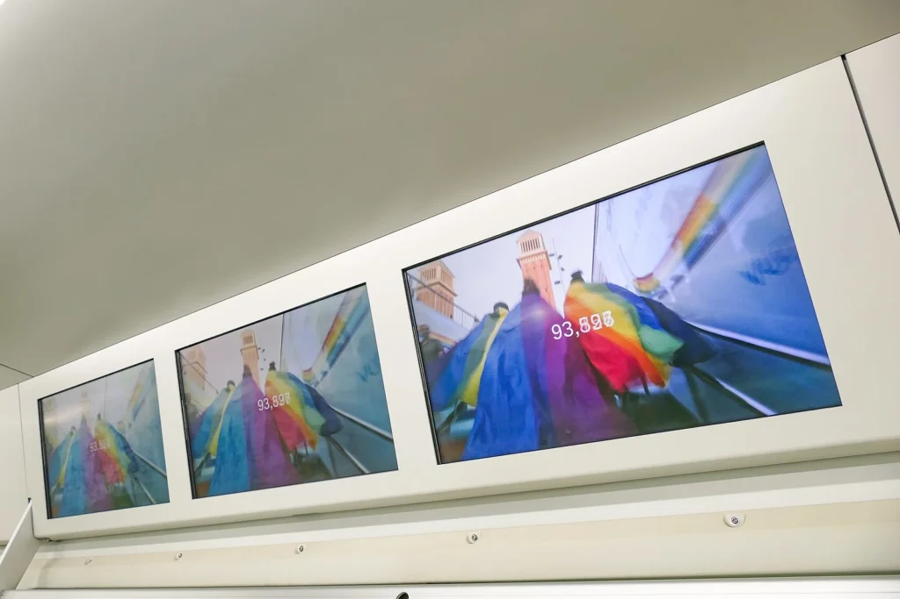
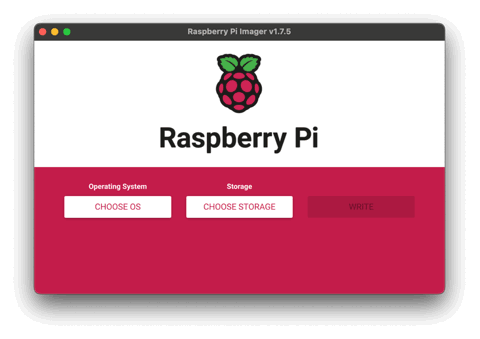

Using a Raspberry Pi with Google Slides is an excellent way to make very cheap and effective digital signage. In this guide I will show you how to build this. This is an updated method as the Screenly / Anthias software doesn’t seem to like 4K screens for Google Slides! And the beauty of it: once you set it up, you don’t have to touch the Pi again, just edit the Google Slides presentation and watch your screens update!

**UPDATE: The Raspberry Pi Trading Company have just announced the release of the Raspberry Pi 5. [Read all about it on my new post here](/posts/2023/09/raspberry-pi-5-announced/). (It can run dual 4K displays, so it will be perfect for your next digital signage project!)**

- [What you need:](#what-you-need)
    - [Step 1: Prepare your Google Slides presentation for Digital Signage](#step-1-prepare-your-google-slides-presentation-for-digital-signage)
    - [Step 2: Prepare the SD Card](#step-2-prepare-the-sd-card)
    - [Step 3: Log in and setup the Pi](#step-3-log-in-and-setup-the-pi)
    - [Bonus step: Auto power off and on](#bonus-step-auto-power-off-and-on)



## What you need:

- [Raspberry Pi 4](https://amzn.to/458Ooze) and power adaptors etc
    

- [Big screen or TV](https://amzn.to/48vV4uc)
    

- [SD Card 8GB or larger](https://amzn.to/3ZyYyrO)
    

- Google account
    

- About 30 minutes!
    

### Step 1: Prepare your Google Slides presentation for Digital Signage

Before we start, you should have a Google Slides presentation prepared that you want to show on your digital signage. Make the presentation with no transitions or timings, as it will be set to the same timings for every slide in the sharing phase.

Once you are happy with your slides, click on File -> Share -> Publish to Web. Then choose to advance slides every X seconds (set it to 5 if just images, longer if your slides will have a lot of text to read)

Make sure that the “Start slideshow as soon as the player loads” and  
“Restart the slideshow after the last slide” boxes are ticked.

Then click Publish.

Copy the URL that is shown and save it somewhere you can get later.

### Step 2: Prepare the SD Card

Download Raspberry Pi Imager from [https://](https://www.raspberrypi.com/software/)[www.raspberrypi.com](https://www.raspberrypi.com/software/)[/software/](https://www.raspberrypi.com/software/)

<figure>



<figcaption>

Preparing the SD Card for your Digital Signage

</figcaption>

</figure>

- Click on Choose OS
    

- Select Raspberry Pi OS (other)
    

- Select Raspberry Pi OS Lite (64-bit)
    

- Select Choose Storage
    

- Choose your memory card from the list (be careful not to select the wrong drive!)
    

- Click on the gear icon
    

- Choose a hostname for the device
    

- Enable SSH using password authentication
    

- Set the username and password
    

- Configure Wireless if you will be using it (I use Ethernet for a more reliable connection)
    

- Set Locale Settings (not essential but makes date and time correct)
    

- Hit Save
    

- Now click Write to wipe and install on the SD Card
    

Once complete, put the card in to the Raspberry Pi and fire it up.

### Step 3: Log in and setup the Pi

Log in using SSH with whatever username and host name you gave the Digital Signage Pi during the SD Card prep phase. For example “`ssh Colin@digitalsign.local`”

Update the software on the Pi first by using the following command

```
sudo apt update && sudo apt upgrade -y
```

This will update the Pi software list followed by installing all of the missing updates. The -y on the end just tells it to go ahead without prompting you for confirmation.

Once this is done we will install the packages needed to put our Pi into Kiosk mode. We will install Chromium browser and set it up to launch a webpage (our Google slides presentation) and make that page fullscreen.

```
sudo apt install --no-install-recommends xserver-xorg x11-xserver-utils xinit openbox chromium-browser -y
```

Once this installation has completed we just need to configure the browser to launch at login and tweak a few other settings.

First of all we need to make sure the Pi is in the correct graphics mode. Do this by editing the config.txt file in the boot folder.

```
sudo nano /boot/config.txt

or on the newer BookWorm Pi OS Lite
sudo nano /boot/firmware/config.txt
```

Look through the file to find the line similar to  
dtoverlay=vc4-kms-v3d

Make sure that it reads dtoverlay=vc4-**fkms**\-v3d and NOT **kms** (that little f is very important, without it the slides can be a little jerky)

Once that is done, save the file by pressing Ctrl-O then Return to save and then Ctrl-X to exit.

Next we will edit the file /etc/xdg/openbox/autostart using the command below.

```
sudo nano /etc/xdg/openbox/autostart
```

And then copy and paste the following code into the file, making sure to edit the “your-url-here” bit at the end. In here you want to paste the Google slides publish URL we got in Step 1.

```
# Disable screen saver / screen blanking / power management
xset s off
xset s noblank
xset -dpms

#Allow quitting the X server with CTRL-ATL-Backspace
setxkbmap -option terminate:ctrl_alt_bksp

#Start Chromium browser in kiosk mode
sed -i 's/"exited_cleanly":false/"exited_cleanly":true/' ~/.config/chromium/'Local State'
sed -i 's/"exited_cleanly":false/"exited_cleanly":true/; s/"exit_type":"[^"]+"/"exit_type":"Normal"/' ~/.config/chromium/Default/Preferences
chromium-browser --disable-infobars --kiosk 'http://your-url-here'
```

Again, Ctrl-O and Return to save the file and then Ctrl-X to exit nano.

Next we will make the X server start on login. Edit the .bash\_profile file by doing  
`nano ~/.bash_profile` and pasting the following code and saving using Ctrl-O then Return followed by Ctrl-X to exit.

```
[[ -z $DISPLAY && $XDG_VTNR -eq 1 ]] && startx -- -nocursor
```

Now we need to tell the Pi to autologin every time it restarts so that the slides will display automatically. Do this by running `sudo raspi-config`.

In the text menus that appear choose **1\. System Options**, then **S5 Boot / Auto Login** and then choose **B2 Console Autologin**  
Then press Tab twice to highlight Finish and hit Return. When asked to reboot choose Yes.

The Pi will now reboot and when it comes back on it should auto login in start to display your slides!

Congratulations! You have just built a very cheap and fast digital signage solution. Hook it up to a nice big TV and you are off!

### Bonus step: Auto power off and on

When I use this method to make digital signage I like to use the crontab to turn the display off and on using a schedule. Most modern TVs will go into standby mode when the HDMI source turns off, saving energy when your display is not in use.

To edit the crontab use `sudo crontab -e`

If it is your first time it will ask what you want to use to edit it, I suggest nano as we are used to this from previous steps.

Here is the crontab I use

```
#reboot the Pi Mon-Fri at 8am. This refreshes the slides and ensures the TV wakes up
0 8 * * 1-5 sudo reboot >/dev/null 2>&1

#this turns the display output on
15 8 * * 1-5 sudo vcgencmd display_power 1 >/dev/null 2>&1

#Disable HDMI end of day Mon - Fri 530pm. TV should go to sleep after
30 17 * * 1-5 sudo vcgencmd display_power 0 >/dev/null 2>&1
```

I hope this guide is useful to you, please share it and let me know how you use your Pi in digital signage!
