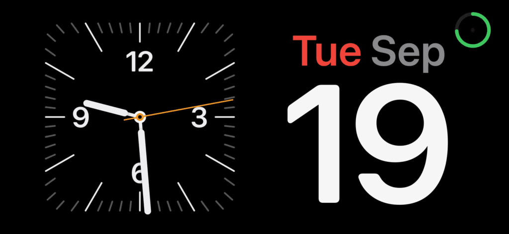
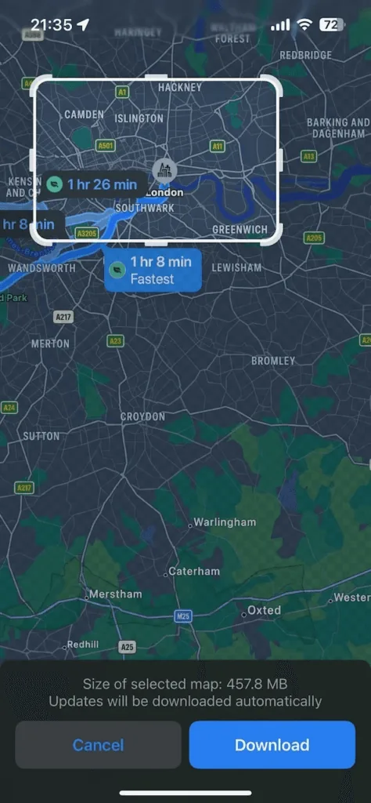

The iOS 17 update has just released for iPhone and iPad and it has some fantastic new features. Many are small but they have a big impact. Here are a few of my favourites.

## Live Voicemail

This is great. If someone is leaving you a voicemail message you can see it as live text coming through. If it is someone you want to speak to you can answer and interrupt the voicemail.

This allows me to silence all unknown callers and be confident that I wont miss something important. All while still keeping all those scam calls at bay.

## Standby mode

Standby is a new mode in iOS 17 that activates when your phone is charging and is horizontal. Luckily [my charging stand](https://amzn.to/3PqDuip) still works when my phone is horizontal so I tried this last night and it is awesome.

You can choose some widgets to display (I just chose the date and the clock to start) and if the ambient light is low it will display in a muted red colour which is perfect when you wake in the middle of the night and need to check the time without searing your retinas!

## Interactive widgets

This is huge. The widgets that you already can have on your home screen are now interactive in iOS 17. I am using this with [Things](https://culturedcode.com/things/) (my task manager of choice, why not check out my [Things I use page](/things-i-use/) for other cool things I like to use) so that I check things off my list without opening the app.

This is also great with the Home app so you can turn lights on and off directly from the home screen without opening the app. This one is a great quality of life improvement.

Oh and don’t forget to update your apps, as many app authors will be thinking up even more clever uses for these widgets over time (and make sure you check out [WidgetSmith](https://apps.apple.com/us/app/widgetsmith/id1523682319) which allows you to create your own custom widgets!)

## Verification codes email autofill

You know when you log into a site and they send you a 6 digit codes as a text? In iOS 16 they would autofill those for you which was super convenient but only for SMS messages. In iOS 17 it now detects codes in your email too! This is such a great addition and I will be using this a lot!

## Offline Maps

In Maps in iOS 17 you can now choose to download Offline maps. If you are planning to go for a hike or a long drive and you might not have data coverage, this will be super useful.

## Autocorrect corrected

You know how when you are typing and you type a word the phone doesn’t recognise and it corrects it? Then you go back, put it back the way you want it and then it corrects it AGAIN! Well that little infuriation has been fixed. Which also makes it much easier to use swear words. About ducking time!

## Check in

In Messages there is a new Check in feature. This allows you to have your phone automatically alert someone when you reach a specified location, for instance to let them know you got home safely. You just tap the plus button when in a message with the person you want to alert and choose Check In.

If you don’t arrive at your location, or it looks like you have stopped moving towards it, it will prompt you to see if everything is ok. If you don’t respond, it will send a message with your last location to the person you are checking in with.

I think this will be excellent for parents so their kid doesn’t forget to let them know when they reached their friends house, or if you are waiting for a friend to get an Uber or taxi home safely.

## Multiple Timers (FINALLY)

FINALLY! Now you can add multiple timers. In the kitchen being able to add timers for multiple things at once is table stakes (pun intended) and it is kind of silly how long it has taken for Apple to add this. But it is here now! Rejoice!

* * *

These are just a few of the new things I am loving about iOS 17 and I am sure I will find more. But these are a great place to start to get more from your devices!
