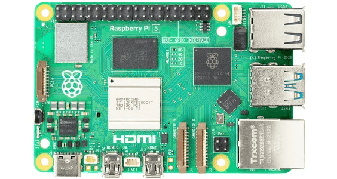
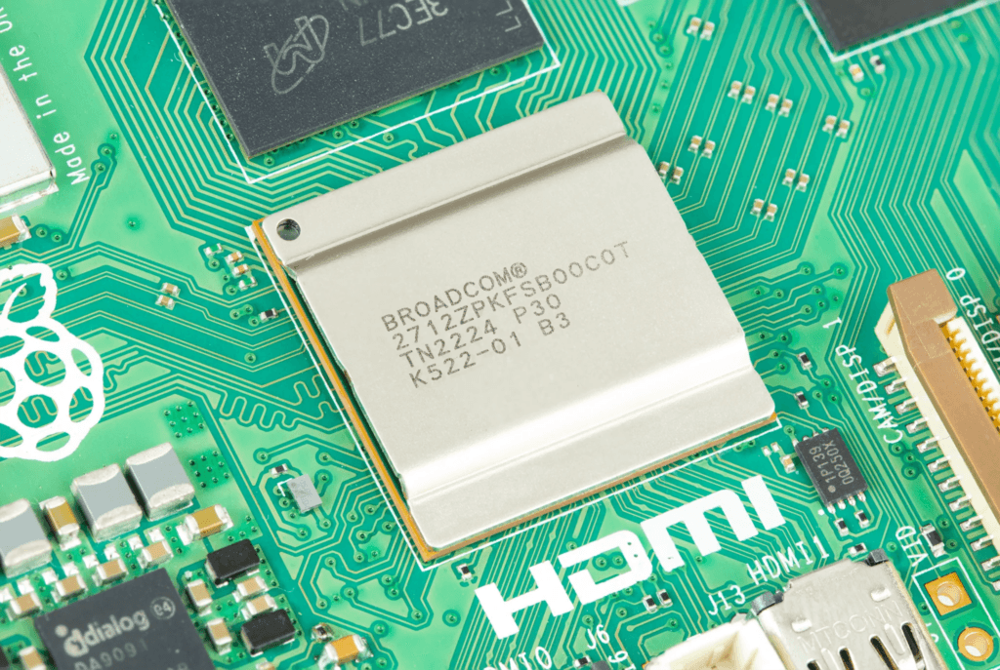
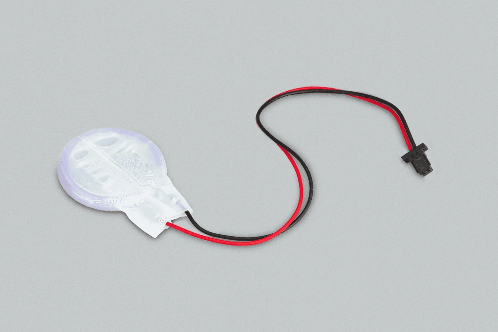

The [Raspberry Pi Trading Company](https://www.raspberrypi.com/news/introducing-raspberry-pi-5/) have just announced the Raspberry Pi 5 and it is available to pre-order now, shipping in late October. Of course they announced this less than 24 hours after I [wrote a post about using the Raspberry Pi 4 for Digital Signage](https://intelligentdithering.com/digital-signage-on-a-budget-with-raspberry-pi-and-google-slides-in-2023/)! This new Pi will be even better for that as you will be able to run two 4K screens at once with it!

So what is new and exciting in this updated single board computer? Read on to find out!

- [CPU - 2-3x faster](#cpu---2-3x-faster)
- [GPU Updated](#gpu-updated)
- [USB bandwidth doubled](#usb-bandwidth-doubled)
- [MicroSD slot twice as fast](#microsd-slot-twice-as-fast)
- [PCI-Express!!!](#pci-express)
- [Dual camera / display slots](#dual-camera--display-slots)
- [Raspberry Pi 5 gets a POWER BUTTON!!](#raspberry-pi-5-gets-a-power-button)
- [Real-time Clock](#real-time-clock)
- [Others](#others)
- [Conclusion](#conclusion)

## CPU - 2-3x faster

The CPU has been replaced with a new Broadcom BCM2712 64-bit quad core ARM Cortex-A76 processor that is between 2 and 3 times faster than the one on the Pi 4. This will be a noticeable boost in performance for all users.

## GPU Updated

The Raspberry Pi 5 has a VideoCore VII GPU on board able to run dual 4Kp60 displays without breaking a sweat. This upgrade should also be a major boost for the retro gaming emulation solutions out there, which will make the Pi 5 pretty much the ultimate retro gaming machine!

## USB bandwidth doubled

USB ports now have double the bandwidth on the Raspberry Pi 5 and there are 2x USB 3 and 2x USB 2 ports. This will make running from portable drive significantly faster and should allow for more scope when building network attached storage solutions using the Pi. Plex server on the Pi could be on the cards again!

## MicroSD slot twice as fast

The MicroSD slot has been upgraded to be twice as fast on Raspberry Pi 5, and combined with the CPU upgrades I think this will really be noticeable in daily use. Boot-up times will feel incredibly quick with this upgrade as long as you [get a decent SD card](https://amzn.to/3RCrcpU) to take advantage of it.

## PCI-Express!!

Yes you read that right. The card has a port to break out a single lane PCI-Express port which should open up tons of possibilities for connecting high speed peripherals in the future. Think 10Gig ethernet cards, possibly graphics cards and fast storage RAID solutions. This is a space to watch!

## Dual camera / display slots

These dual CSI/DSI ports will support any combination of up to two cameras or displays. But beware, the connectors are different on the Raspberry Pi 5 compared to the old CSI ports so you may need to buy new ribbon cable adaptors to make your existing kit work. Plenty of the usual stockists will have these cables ready for launch.

## Raspberry Pi 5 gets a POWER BUTTON!

This might be the biggest FINALLY of all! They have added a power button to the Raspberry Pi 5 so you no longer have to pull the USB cable out or go hoking under your desk looking for the power switch. And the new Raspberry Pi official case comes with an outer button lined up to this for easy access.

## Real-time Clock

The board also has a built in RTC which you can power with a two pin connector to a coin cell battery. This is fantastic for projects that require time and date but may not have Internet access to set the clock on each boot. Very welcome addition.

## Others

There is also a dedicated fan header for connecting PWM fans to (the new Raspberry Pi 5 official case will come with a fan included). And a dedicated UART header for making debugging simple.

It should also be noted that the Pi uses less power than it’s predecessor but they sell a beefier 5v 5A power supply with USB-PD support to allow for overclockers and also to provide increased power to the USB ports if you wish to run more power hungry peripherals.

## Conclusion

Overall this is a fantastic upgrade to the Pi 4, which was an amazing single board computer. The speed difference will be very noticeable and I think this firmly puts the Raspberry Pi 5 into the realm of being a perfectly good daily computer for most normal users.

The Raspberry Pi 5 will be available at launch in 4GB and 8GB flavours priced at $60 and $80 respectively. They can be pre-ordered now and will ship on 20th October 2023.

Do I need one? No, I have many Pis already.  
Will I be ordering one? Almost certainly.

And I will continue to until someone starts Pi Users Anonymous so I can get some help!
