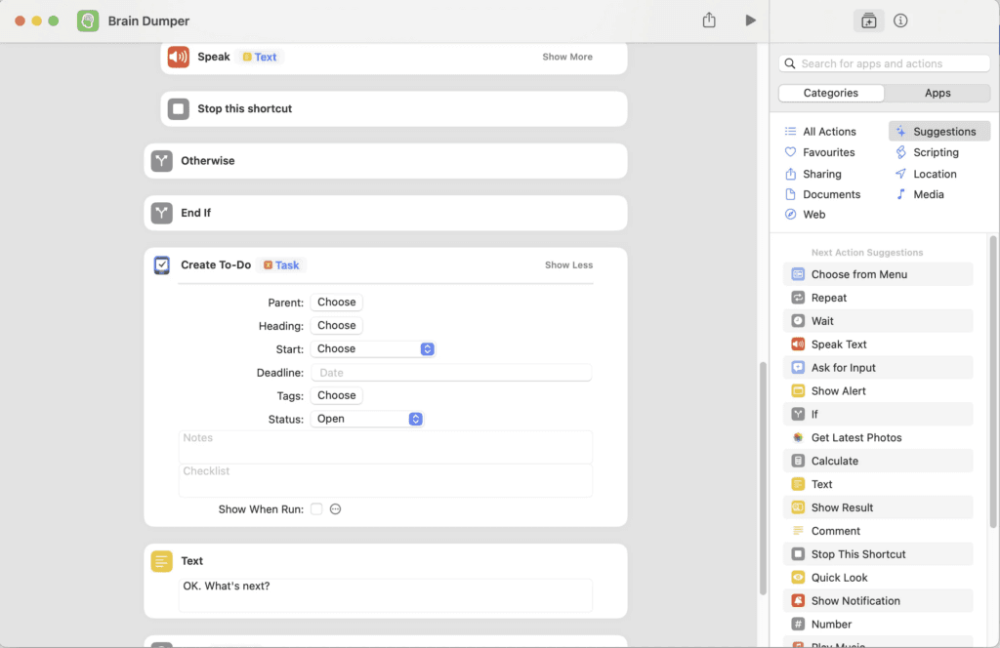

- [Introduction](#introduction)
- [So how do we combat Messy Brain / overwhelm?](#so-how-do-we-combat-messy-brain--overwhelm)
- [Enter the Brain Dumper iOS shortcut!](#enter-the-brain-dumper-ios-shortcut)

## Introduction

Get things out of your head and into your task manager FAST with this free iOS shortcut!

I use my devices for everything. My iPhone is always at hand and I am never far from my iPad or Mac. Having my to-do list all in one place that I can access at any time is critical for me to function.

With my [particular cocktail of mental disorders](/posts/2020/03/improving-mental-health-during-troubling-times/) I find that sometimes I can get a serious feeling of overwhelm. My wife calls this “Messy Brain”, and it’s pretty obvious when it is happening to me. I tend to dull down, withdraw, get even more introverted than normal and just feel totally “meh”.

The human brain’s working memory can really only hold around [7 items (plus or minus 2)](https://en.wikipedia.org/wiki/The_Magical_Number_Seven,_Plus_or_Minus_Two#:~:text=It%20was%20written%20by%20the,memory%20is%207%20%c2%b1%202.) at a time before it runs into problems. This is not ideal for holding a task list of 30 or 40 things you need to do. Inevitably you will forget them: as another item gets added to the list, one drops off the end. But the brain still remembers that there WAS something on that list. You don’t know what you have forgotten but you DO get the horrible dread that you are going to drop the ball. That’s when Messy Brain kicks in.

## So how do we combat Messy Brain / overwhelm?

The first course of action I take when this happens is to notice it. Once I have accepted I am in overwhelm mode, I just need to get everything out of my head in front of me so that it is easier to break down into smaller chunks to process.

Usually I would write things down but I find that can be too slow for me (in many cases the “slowness” of writing things down can actually be a benefit, especially when journalling as it makes you take more time to reflect properly).

I needed a fast way to get things into my task manager of choice **[Things](https://things.app)**. Things is pretty good about quick task entry on all platforms but it relies on typing, and one of the time I get a chance to dump my tasks out of my head is on my commute. I needed a way to get things off my mind fast and into Things so I can easily sort them again later.

This has been bugging me for a while as trying to use Siri to do it is a pain in the car.

You have to say:

> ME: “Hey Siri, add a task to Things”
> 
> SIRI: “Ok, what do you want me to add to things?”
> 
> ME: “Write a blog post”
> 
> SIRI: “OK, I have added Write a blog post to Things”

Then repeat that whole process for each item.

I wanted a way to dump tasks out fast with minimal speech in between all from a single button press or voice command. It was time to make an iOS Shortcut to do the heavy lifting!

## Enter the Brain Dumper iOS shortcut!

[Download the Brain Dumper Shortcut for Things](https://www.icloud.com/shortcuts/d33b93a222184073abc2e2e3297a940c)

[Download the Brain Dumper Shortcut for Reminders](https://www.icloud.com/shortcuts/35a6c4374fb34632af6dacaea52794ee)

You can use this iOS shortcut I made to achieve this. Tap the link to install it in the Shortcuts app on your iPhone / iPad or Mac.

You can invoke the iOS shortcut by tapping it or simple saying “Siri, Brain Dumper”

The conversation flow is more like this now:

> ME: “Siri, Brain Dumper”
> 
> SIRI: “What would you like me to add to Things? What’s the text?”
> 
> ME: “Buy milk”
> 
> SIRI: “Ok what’s next?”
> 
> ME: “Publish blog post”
> 
> SIRI: “OK. What’s next?”
> 
> ME: “Admire this amazing shortcut”
> 
> SIRI: “OK. What’s next?”
> 
> ME: “Stop”
> 
> SIRI: “OK. All done.”

You can see this is a much faster interaction, both in the adding of a single task and the fact it asks repeatedly for more tasks until you say “Stop”.

Once you have downloaded the shortcut you can customise the spoken prompts and the task app that you prefer, just swap out the Things block for the app you use. For example I duplicated this Shortcut and changed the target app to Reminders, and we use that to quickly add a list of items to our family shared Shopping List in Reminders. This means you can open the kitchen cupboards and just shout ingredients to your phone to get the list entered quickly. It is a game changer!

Let me know if you use this iOS shortcut and if you have any cool tweaks to make it better!
