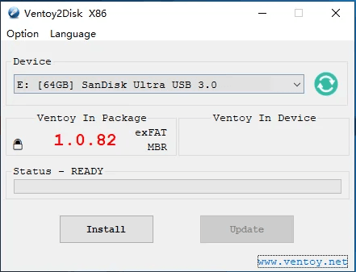
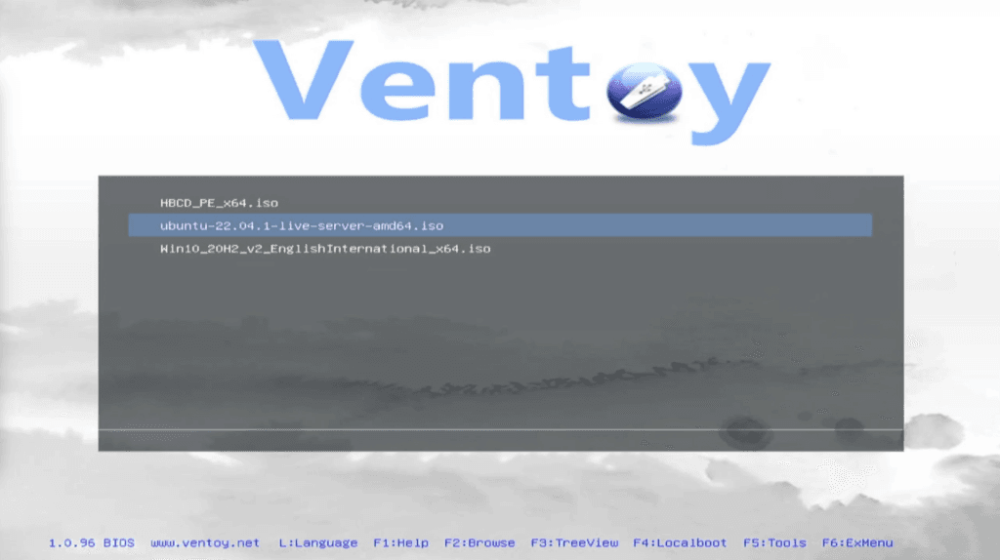

_Creating a USB Swiss army knife full of tech tools for all your geeky needs_

Today we are going to make the ultimate bootable USB drive to have with you at all times. This is an invaluable tool and it is all made possible by the Open Source tool [Ventoy](https://ventoy.net).

This post is available in video form on YouTube as well for the visual learners among us.



Ventoy is basically a bootloader that goes onto a USB drive that allows you to easily boot from any of the ISO disc images contained within it. This allows you to have a single USB drive with all of the tools you need on it, Windows installer images, file rescue kits, hacking tools etc.

It lets you make a personalised USB Swiss army knife of all the tools you use most often.

## Preparation to make the bootable USB drive

What do we need to begin:

- **A USB drive to hold our ultimate bootable USB toolkit**  
    I find that keeping the drive below 128GB helps with compatibility with some older BIOS versions. I found [this great](https://amzn.to/3s1rVGK) [little](https://amzn.to/3tTzfEV) [drive](https://amzn.to/3s1rVGK) [on](https://amzn.to/3MlhHYI) [Amazon](https://amzn.to/3s1rVGK) that I use personally
    

- **The Ventoy application**  
    You can get this from [Ventoy.net](https://ventoy.net) for either Linux or Windows. Download the appropriate file and extract the contents of the zip file.
    

- **ISO files you want to boot from**  
    You will need some disk images that you want to put onto the bootable USB drive. I would recommend things like the [Windows installer DVDs](https://www.microsoft.com/en-gb/software-download/windows10), [Hirens BootCD](https://www.hirensbootcd.org), [Clonezilla](https://clonezilla.org), SystemRescue etc. Maybe even a [Ubuntu Live CD](https://ubuntu.com/tutorials/try-ubuntu-before-you-install#1-getting-started) would be useful!
    
      
    

## Creating the bootable USB drive

Once you have the Ventoy application downloaded, extract the files and run the file called Ventoy2Disk.exe

You will get a window like the one below.

Choose your bootable USB drive in the dropdown and **double check to make sure it is the right one**. This tool will destroy all data on the drive so be very sure at this stage!

Click **Install**. It will warn you twice that it is going to wipe the drive before proceeding. The process only takes 20 seconds or so.

Once it has completed you will have a new USB drive show up in Windows Explorer named Ventoy.

Now all you have to do is copy over your ISO files to that drive. It really is that simple!

If you need to update or add a new ISO file in the future, just plug the drive in and copy the files over. You do not need to run the Ventoy2Disk app again unless you wish to update the Ventoy boot loader (perhaps if they release updates to fix bugs on certain systems)

## Using your new bootable USB drive

Once you have made the drive and copied over some ISO files now you just need to try it out.

Plug the drive into a computer and turn it on. If the computer is set to boot from USB drives, the Ventoy boot window will appear. If not you may have to press the appropriate key to bring up the boot menu on your computer (typically one of the top row function keys)

When the Ventoy window appears, simply choose the ISO you wish to boot from and hit Return. It really is that easy!

No more lugging around a bag full of poorly labelled USB drives with every possible Windows or Linux install on them. Everything in one place on your new Swiss army knife of IT tools!

Let me know if you find this useful and what tools you like to put on your bootable USB disk.
