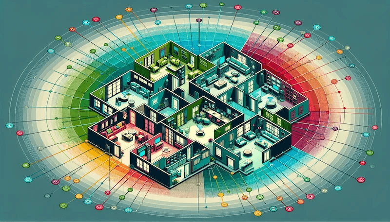

You may have heard of or seen “mesh networks” mentioned on the Internet.  What are they and why on earth would you need one?

Well today we are going to answer those questions and convince you that you need one at home!

- [What problem do mesh networks solve?](#what-problem-do-mesh-networks-solve)
- [How do mesh networks help me?](#how-do-mesh-networks-help-me)
- [Mesh networks to the rescue!](#mesh-networks-to-the-rescue)
- [Extra benefits of mesh networks](#extra-benefits-of-mesh-networks)
- [Pro tips](#pro-tips)
    - [Naming the network](#naming-the-network)
    - [Disable the ISP router Wi-FI](#disable-the-isp-router-wi-fi)

## What problem do mesh networks solve?

Mesh networks are a solution to poor wireless connectivity in the home. In a typical home network, you will have a router supplied by your Internet provider. This will sit in your hall and provide Internet access to the plethora of wireless devices we rely on (phones, tablets, laptops, smart TVs etc). 

In a small home this setup will usually suffice, but in larger homes or ones with lots of walls or a complex layout, you will tend to get Wi-Fi “dead zones”. These are areas with very low or no signal, resulting in slow or flaky internet and you have to wait for that all important [next YouTube video](https://www.youtube.com/@intelligentdithering) to buffer and load! No good!

Mesh networks are a way to cover your home in quality Wi-Fi and make buffering and drop-outs a thing of the past. Some of them also offer additional features like parental controls, firewall and internet safety options and even some smart home functions.

## How do mesh networks help me?

In “the olden days” you could add extra Wi-Fi access points to your home network but they would have to be named differently. One called “Downstairs", one called “Upstairs", maybe another called “Family room”. When you move from downstairs to upstairs, the signal on your device would drop down and if it cut out completely, it would automatically connect to the “Upstairs” access point. In doing so, it would lose connection for a few seconds, which could cause problems with streaming video etc. 

But worse than that, if you still had a very weak signal from downstairs, it wouldn’t be smart enough to switch over and you would have to manually disconnect from one and connect to the other. And of course you would forget to do this and just curse the Internet! Dark times.

## Mesh networks to the rescue

In a mesh network, all of the access points are named the same, so you just have one “Home” Wi-Fi network. All of these mesh network nodes communicate with each other to make the network smart, so when you move from downstairs to upstairs, they detect that you are closer to the upstairs one and they “hand off” your device to the closest node. This is done seamlessly using a technology called “roaming” and this means no break in connection.

And best of all, it is totally invisible to you. You just move about the house and always have great signal and don’t have to think about it. Your Internet connection becomes as reliable as electricity or running water, it’s just there and you don’t have to consider it.

Even better than that, they just need plugged into the mains. No need to run network cables between them all (although if you can it will help speeds). Just plug them in, set them up with a handy smartphone app and enjoy.

## Extra benefits of mesh networks

As previously mentioned, many of these mesh systems can also provide more features. As many of them can actually replace your ISP router entirely, they have firewalls, port forwarding options (for when you get more techy and want to run servers in your house!) and even parental controls. This lets you see what devices are connected, turn off the Internet at night on the kids devices (or just pause it at dinner time to get them down the stairs!). 

Some of the mesh systems, like the fancier [Amazon Eero](https://amzn.to/3QxhD9z) systems also include [Zigbee](https://en.wikipedia.org/wiki/Zigbee) hubs to connect smart home devices to. 

## Pro tips

If you are going to use a mesh system here are two very important tips that will make the whole process much smoother.

### Naming the network

When you have to choose the Wi-Fi name and password for your new mesh network, just use the same name (also called SSID) and password as your current Wi-FI network. This means you won’t have to go around all of your devices typing in the new details, they will already know how to connect! Huge time saving.

### Disable the ISP router Wi-FI

If you are not replacing your ISP router with the mesh systems, then be sure to disable Wi-FI on the ISP device, otherwise the mesh will not function correctly. You should be able to log into the ISP router with details printed on the back and find the Wi-FI section and disable both 2.4Ghz and 5Ghz radios on it. This will allow the mesh to control all of the Wi-FI and leave the router to take care of the Internet connection.

You will also want to make sure your mesh network is set to Access Point only or Bridge mode if retaining your ISP router.

I hope this has been useful in explaining what a mesh network is and why you would want one. I use the [TP-Link Deco P9](https://amzn.to/3QOiDHU) system currently at home but have my eye on an [Eero Wi-Fi 6](https://amzn.to/3QxhD9z) system in the near future!

Happy tinkering!
