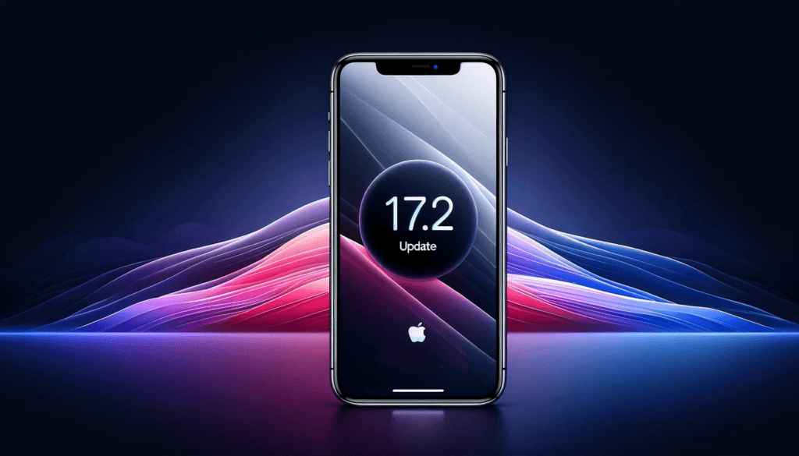
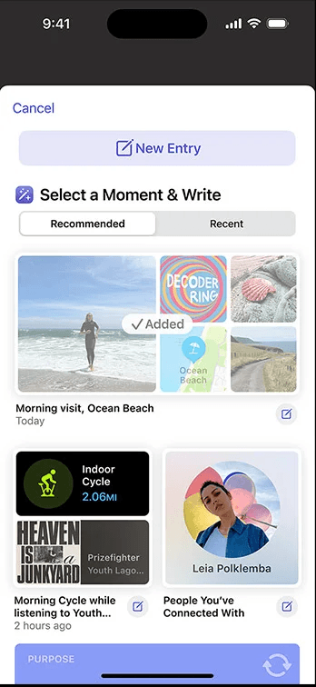

Apple has released iOS 17.2 and iPadOS 17.2 today. There are several improvements and new features worth knowing about that make this an update you don’t want to miss.

- [Journal App](#journal-app)
- [Catch-up in Messages](#catch-up-in-messages)
- [Favourite songs playlist](#favourite-songs-playlist)
- [AirDrop Upgrades](#airdrop-upgrades)
- [Smart Autofill for PDFs](#smart-autofill-for-pd-fs)
- [Digital Clock Widget](#digital-clock-widget)
- [More weather widget options](#more-weather-widget-options)
- [Spatial Video recording](#spatial-video-recording)
- [Action button translate option](#action-button-translate-option)
- [Qi2 Charging support for iPhone 13 and 14](#qi2-charging-support-for-iphone-13-and-14)

## Journal App

Apple have finally released their Journal app. It will prompt you several times a day to reflect on your mood and what might be causing you to feel that way, in an attempt to step back from the feelings and analyse your behaviour. Journalling has been shown to help with many mental health issues and [I use it myself](https://intelligentdithering.com/lockdown-mental-health-1-year-later/), but I am not sure I will switch from my Obsidian plain text method to this.

Apple says:

> Journal is a new way to reflect on and relive special moments. Capture your thoughts on life’s big events or everyday activities. Add details to any entry with photos, music, audio recordings, and more. Mark important moments and revisit them later to find new insights or set new goals.
> 
> Your iPhone can create personalized suggestions of moments to remember and write about based on information like your photos, location, music, workouts, and more—all using on-device machine learning.

Other apps can tie into the Journalling app using an API, so I expect this feature to bloom over the coming months and will revisit it when new use cases appear.

## Catch-up in Messages

This is a small feature but very useful, and honestly one I am shocked has taken so long to appear! When you open a conversation with a lot of unread messages, you can tap on the little ^ symbol in the top right to scroll to the first unread message in a thread.

## Favourite songs playlist

If you open the Music app on your iOS 17.2 device, you will notice a new Favourite Songs playlist. This will highlight all of the songs you have ever hit the favourite button on over the years and will automatically update as you add new ones.

You can ask Siri to ‘play my favourite songs’ now and you know you will get things you like!

## AirDrop Upgrades

As well as NameDrop (for quickly bumping phones together to swap contact details) iOS 17.2 can also use this proximity feature to share other items such as boarding passes, movie tickets etc.

This is a nice little tweak to make sharing things quicker.

## Smart Autofill for PDFs

If you receive a PDF that contains form fields you can now auto fill some of these with your saved contact details. Huge timesaver if you frequently do this with PDFs!

## Digital Clock Widget

If you want to have a clock widget on your home screen, you previously had to make do with various analog options. No more! Now you can have a quick, easy to read digital version on your home screen!

## More weather widget options

If you are a weather nerd, the Weather app has been upgraded to include more details including precipitation and snow conditions of the next ten days, wind map snapshot to see wind patterns (useful for kite-surfers!) and an interactive moon phase calendar to see what phase it will be in at any point in the month (useful for astronomers and night photographers).

## Spatial Video recording

If you have an iPhone 15 Pro or 15 Pro Max, you can now record videos in the new “Spatial video for Apple Vision Pro” mode. Not a huge amount of use at the moment, but any videos recorded in this mode will appear 3 dimensional when viewed on the upcoming Apple Vision Pro AR headset. Only 1080p and 30fps for the moment.

## Action button translate option

If you have the new iPhone 15 Pro you can allocate a new feature to the Action button (it is the one that replaced the mute / silent switch). Now you can have it fire up translate for automatic voice-to-text translation between two languages. If you haven’t tried the Translate app you really should give it a go, it feels like the universal translator from Star Trek is not too far away!

## Qi2 Charging support for iPhone 13 and 14

If you have an iPhone 13 or 14, you can now take advantage of Qi2 compatible chargers. These contain magnets to better align the charging coils in the two devices and unlocks up to 15 watts of charging power, resulting in faster and more efficient charges.

What features are you most excited about having in this update, or what did Apple miss? Let us know in the comments!
