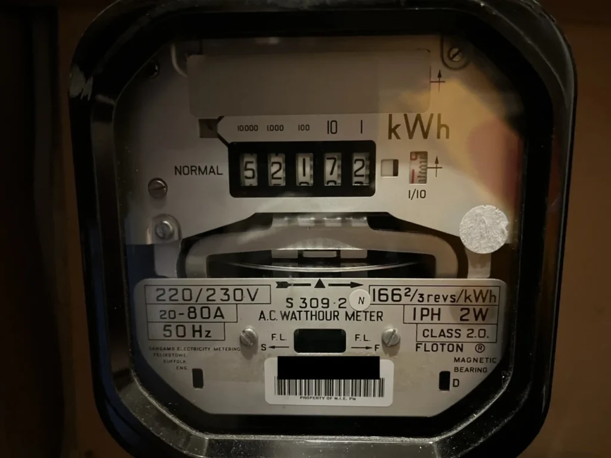
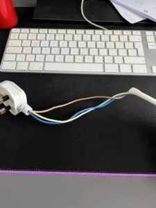
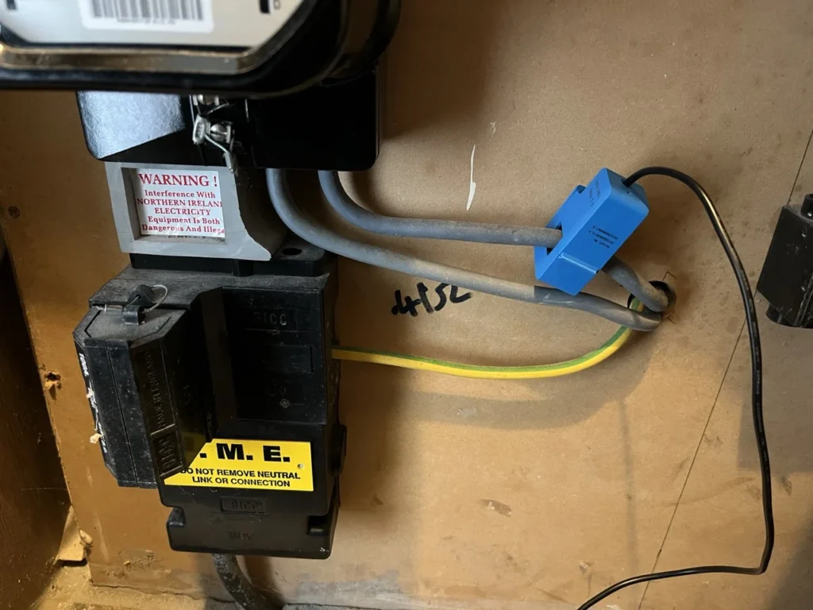
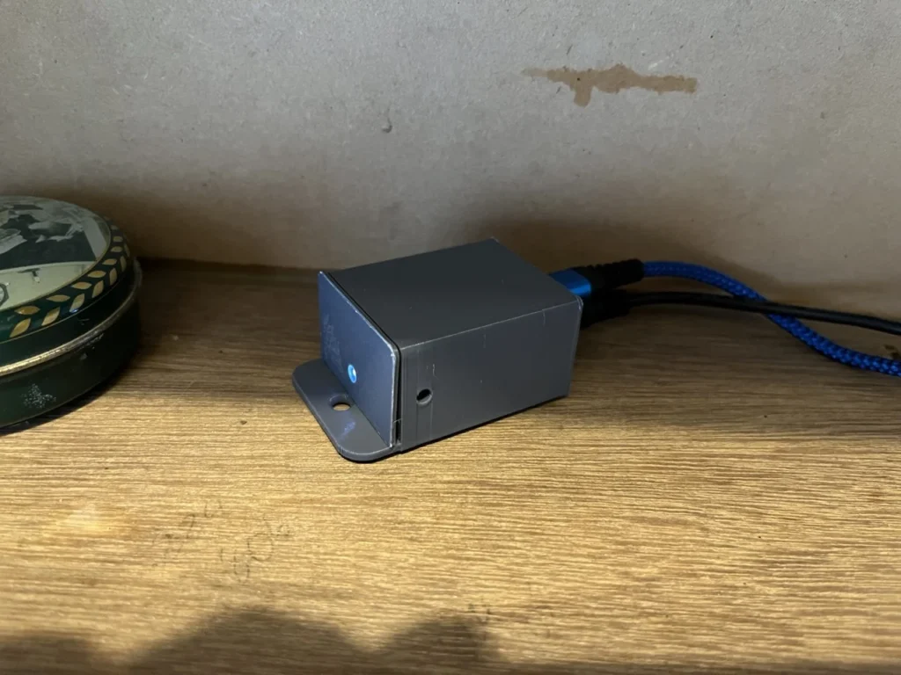
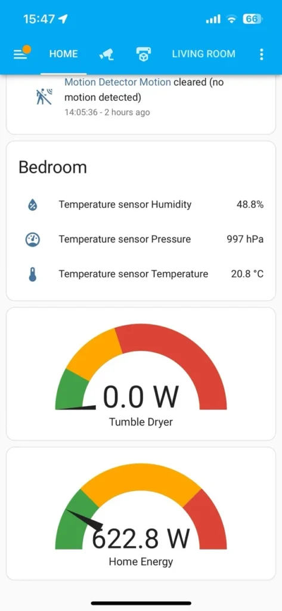

- [Why energy monitoring?](#why-energy-monitoring)
- [Important warning](#important-warning)
- [The Plan](#the-plan)
- [The Parts](#the-parts)
- [Prepare the sensor](#prepare-the-sensor)
- [Install the sensor](#install-the-sensor)
- [Conclusion](#conclusion)

## Why energy monitoring?[](#why-energy-monitoring)

I recently decided I wanted more data on our home energy usage. Unfortunately our meter box is over 20 years old and our energy supplier wont replace it until it is 30 years old. It is an old spinning disk style meter with analog display.



I had considered using a camera and some machine learning to read the digits from the display, but I think monitoring the actual power usage will be much better. Doing this is dangerous however so I needed a way to do it without my wife cashing in the life insurance!

CT Clamps measure the magnetic field coming from an electrical cable. My measuring the strength of the field via the induced current into a coil, you can get a measurement of the current flowing through the wire without being electrically connected to it. Split core CT Clamps make this even safer, by allowing you to “clamp” the sensor around the wire without having to disconnect anything.

## Important warning

**_I am not a qualified electrician. Using even these “safe” CT clamps does have a risk associated with it, and being in and around your electricity meter is obviously risky business. Please consult a suitably certified expert before attempting any of this! YOU HAVE BEEN WARNED!_**[](#important-warning)


## The Plan[](#the-plan)

My plan is to build a small system using some pre-made circuit boards for this purpose. Then install ESPHome onto an ESP8266 chip to allow easy programming and connection with Home Assistant. Once it is all installed, I should be able to have a nice simple gauge on my Home Assistant dashboard showing the live energy usage in the house. Home Assistant will also graph this data historically to allow us to see patterns of use and perhaps adjust our behaviour to help reduce our energy costs.

The parts should cost less that £20 ($25 USD).

## The Parts[](#the-parts)

- [Wemos D1 Mini board with header pins ~£6](https://amzn.to/3IWuZJ3)
    

- [Mottram Labs CT Clamp Adaptor Board (MLP201083 for the D1 Mini) ~£3](https://www.ebay.co.uk/itm/134309518629?itmmeta=01HSPJ0518NW8JBEYSX3PC0K85&hash=item1f45789d25:g:eK0AAOSwV6RjXW7V)
    

- [SCT013-000 100A - 50ma Split core CT Clamp sensor ~£9](https://amzn.to/3TyEwLo)
    

- [3D Printed Case (optional)](https://www.thingiverse.com/thing:3169243)
    

## Prepare the sensor[](#prepare-the-sensor)

The first thing to do was to assemble the parts. This was pretty straightforward once I had the header pins soldered onto the Wemos D1 Mini. Just snap the two parts together and then connected it to my Mac via USB cable.

Then I navigated to the [ESPHome web installer](https://web.esphome.io/?dashboard_wizard). I had to do this using Google Chrome as Safari on Mac does not currently support WebSerial.

Just click Connect and then choose the serial port from the menu that pops up. Add in your home WiFi details and that is your ESPHome device created and it should appear in Home Assistant ready for adoption.

Once I had the device connected to Home Assistant it was time to program it. ESPHome allows you to use YAML files to configure the devices. Simply change the YAML, hit Save and Install and then choose WiFi. This will send your new device configuration over to the ESPHome device and reboot it, displaying logs to show how it went.

Here is the code I used for my sensor:

```
substitutions:
name: esphome-web-6eb49e
friendly_name: CT Clamp

esphome:
name: ${name}
friendly_name: ${friendly_name}
name_add_mac_suffix: false
project:
name: esphome.web
version: '1.0'

esp8266:
board: esp01_1m

# Enable logging
logger:

# Enable Home Assistant API
api:

# Allow Over-The-Air updates
ota:

# Allow provisioning Wi-Fi via serial
improv_serial:

wifi:
# Set up a wifi access point
ap: {}

# In combination with the `ap` this allows the user
# to provision wifi credentials to the device via WiFi AP.
captive_portal:

dashboard_import:
package_import_url: github://esphome/example-configs/esphome-web/esp8266.yaml@main
import_full_config: true

# To have a "next url" for improv serial
web_server:

# Example configuration entry
sensor:
- platform: ct_clamp
sensor: adc_sensor
name: "Measured Current"
id: home_current
update_interval: 15s
filters:
- calibrate_linear:
# Measured value of 0 maps to 0A
- 0 -> 0
- 0.028 -> 8.8

# Example source sensor
- platform: adc
pin: A0
id: adc_sensor

- platform: template
id: my_power
name: "Home Power"
lambda: return id(home_current).state * 230;
device_class: power
unit_of_measurement: 'W'
update_interval: 15s
```

You have to calibrate the sensor using a known load. How I did this was to strip back the out sheath from an extension cable, allowing me to access the live wire separately. I could then clamp the CT over the live wire, and then plug in a known load to the extension cable. I also used a plug in energy monitoring plug to verify results.

<figure>



<figcaption>

Do not make a cable like this!

</figcaption>

</figure>

I ran a hairdryer on its medium setting and saw that it produced 4.4 amps on the digital meter, while the ESPHome chip was reporting 0.014A. I then ran it on max, and saw the digital meter showing 8.8 amps of draw, and the ESPHome showing 0.028.

So in the YAML file under the **calibrate linear** section I add 0 -> 0 and 0.028 -> 8.8. This will then allow the sensor to work out what to convert when taking reading. I should probably have put in more readings to help make it more accurate but for my needs this will suffice.

## Install the sensor[](#install-the-sensor)

Happy that I had reasonably accurate readings it was now time to install the sensor. Luckily for me my power meter has the output cables easily accessible. It was simply a matter of installing the CT Clamp around one of the cables and then powering on the sensor.

I also 3D printed the case for the Wemos and adaptor board to keep everything neat and safe.





Within minutes I had data flowing to Home Assistant. All that was left to do is add it to the dashboard.



I chose to use the Gauge type widget for this and will adjust the markings of the green, yellow and red areas as I monitor our usage.

## Conclusion[](#conclusion)

This was a really fun little project. For under £20 I now have a gauge of how much energy we are using despite having an incredibly old analog power meter.

This project hit a lot of areas: soldering, 3d printing, software, hardware and a little bit of potentially dangerous electricity. Perfect mix for tinkering!

I hope to make a few more dashboard widgets translating the power usage into monetary value to give us a better sense of how much things cost to run. This will hopefully help us as a family adjust our behaviours a little to save some money (and perhaps the planet!).

If you give this a go be sure to heed the warnings and let me know in the comments how you get on!

Happy tinkering!
