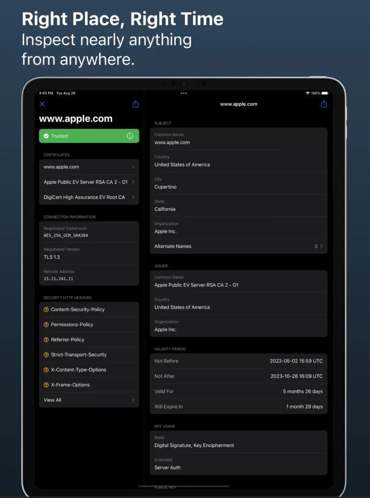
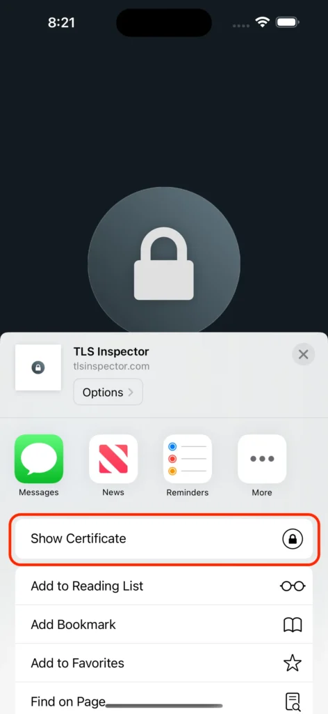

[TLS Inspector](https://tlsinspector.com) is a great **free** app from developer Ian Spence that I use quite regularly at home and _especially_ in work.

It is great for quickly checking for expiry dates on certificates, or why a certificate is not working as expected. You can also delve into the certificate chain to check for any inconsistencies. Very useful if you think a website might be suspect!

There have been other apps like this in the past but the one feature that I particularly love about TLS Inspector is the Share Sheet extension. This allows you to quickly check website you have open in Safari simply by using the share menu. No faffing about copying the URL, switching apps, trying to paste it and remove the non-domain bits.

Just tap “Show Certificate” and off you go!

Download a copy of it for free now [from the App Store.](https://apps.apple.com/app/apple-store/id1100539810?pt=962148&ct=crash-override&mt=8)
