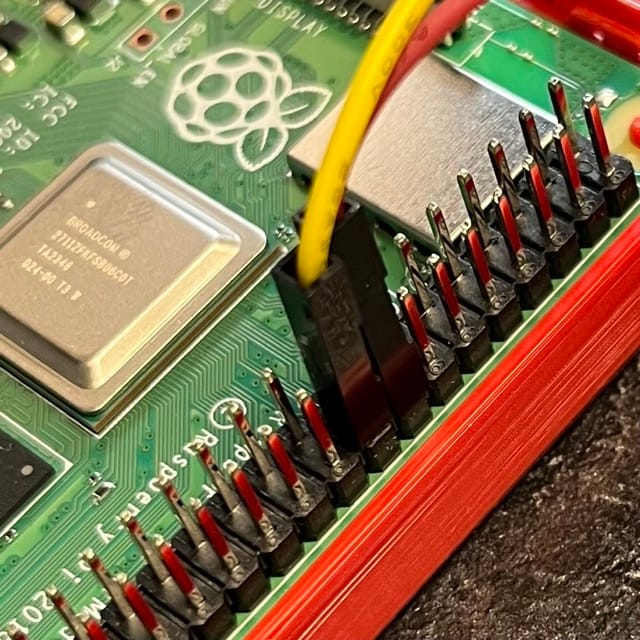

_Building a cheap IP KVM using open source software and Raspberry Pi_



We recently had a small server outage in work. Nothing mission critical, it was over a weekend and coming up to Christmas holidays. It could wait, but that little itch in my brain couldn’t let it sit. I tried several remote remedies to bring it back online but it needed physical access. It had to wait until Monday.

We use older Mac Minis as compact Linux servers and they have been working brilliantly for years. And so much quieter than sitting beside a massive rack of noisy servers!

But if they go down physical access can be a pain as we don’t have a KVM switch. I really wanted to go for an IP KVM switch but they are so expensive! So I figured we could come up with a cheaper solution using, you guessed it, a Raspberry Pi!

So the plan was to get a cheap 8-port USB and HDMI KVM switch, attach it to a [PiKVM](https://pikvm.org/) device to get it on the network and Bob’s your uncle, you now have a DIY IP KVM. I hit a few snags along the way but we got it running, so this is documentation of the process for my own records and to help anyone else hoping to replicate this.

## DIY IP KVM Parts

- 🔗 [8 port HDMI KVM Switch](https://amzn.to/3DOeVKt)

- 🔗 [Raspberry Pi 4](https://amzn.to/40arRl5)

- 🔗 [Micro SD Card](https://amzn.to/40avjwb)

- 🔗 [USB-C Power and Data splitter cable](https://amzn.to/40ruccF)

- 🔗 [HDMI mirror / splitter](https://amzn.to/40pMvz8)

- 🔗 [WaveShare HDMI - CSI bridge for Pi](https://amzn.to/40u3rV6)


## Step 1: Fit the KVM Switch

This part was the easiest. Just hook up all your servers to the KVM switch and test it out.

However it was at this point I noticed what could have been a show stopper. Most KVM switches have a key sequence you can use to switch between machines, usually something like tapping Scroll Lock twice and then hitting Escape, or Scroll Lock followed by the number of the port you wish to switch to. This one didn’t! It comes with a switch panel with 8 buttons on it and an IR remote, as well as being able to press the illuminated buttons on the front panel.

## Step 2: Setup and connect PiKVM

This step is well documented at the [PiKVM website](https://pikvm.org). Basically download the appropriate image for your Raspberry Pi it will be hosted on (I used [a Pi4](/raspberry-pi-5-announced/)), flash it to an SD card, boot the Pi and then SSH in to configure some options.

You will also need to connect the WaveShare HDMI capture device to the CSI port on the Pi and connect the HDMI output from the KVM switch to the Pi.

BONUS TIP: If you connect this via the [HDMI mirror splitter device](https://amzn.to/40pMvz8), you can have the display going to the PiKVM AND a physical monitor, which means we can remote in or just use the physical keyboard etc at the server rack.

Then you will need to connect the power to the PiKVM via the USB-C Power and data splitter cable, so that power goes into the Pi 4 power port and then use a USB-C to A cable to connect the other half to the KVM switch keyboard and mouse port.

This KVM switch has 4 ports so we are able to connect the PiKVM for control as well as a physical keyboard and mouse.

## Step 3: Reverse engineer the control box!

As previously mentioned, the KVM switch did not have keyboard hotkey switching so I couldn’t remotely switch from the PiKVM software. Oops!

So I took apart the control box that was connected via a USB cable. Unfortunately it doesn’t use the USB protocol, just the cables! Luckily a bit of Googling located someone [who had already worked out the communication signals it was using](https://www.reddit.com/r/pikvm/comments/yt0lne/comment/j92dfmv/?utm_source=share&utm_medium=web3x&utm_name=web3xcss&utm_term=1&utm_content=share_button). It seems to send a pulse of varying length to choose the port it switches to.

I used the [Python code from here](https://gist.github.com/mharsch/52b0a99a945711385fb0120020d8226d) and saved it to /usr/local/bin/kvm.py making sure to chmod +x to make it executable.

This [reddit post](https://www.reddit.com/r/pikvm/comments/yt0lne/comment/kzt0lur/?utm_source=share&utm_medium=web3x&utm_name=web3xcss&utm_term=1&utm_content=share_button) also has some useful pointers.

### /usr/bin/local/kvm.py

```
#!/usr/bin/env python
import RPi.GPIO as GPIO
import sys
import time

input_pin = 24  # connected to 'D+' pin on mini USB
output_pin = 23  # connected to 'D-' pin on mini USB

def setup():
GPIO.setmode(GPIO.BCM)
GPIO.setwarnings(False)
GPIO.setup(input_pin, GPIO.IN)
GPIO.setup(output_pin, GPIO.OUT)
GPIO.output(output_pin, GPIO.HIGH)

def get_port() -> int:
while GPIO.input(input_pin) == GPIO.LOW:
time.sleep(0.001)
while GPIO.input(input_pin) == GPIO.HIGH:
time.sleep(0.001)
start = time.time()
while GPIO.input(input_pin) == GPIO.LOW:
time.sleep(0.001)
stop = time.time()
return round((stop - start) * 50)

def set_port(port: int):
GPIO.output(output_pin, GPIO.LOW)
time.sleep(0.02)
GPIO.output(output_pin, GPIO.HIGH)
time.sleep(0.02)
GPIO.output(output_pin, GPIO.LOW)
time.sleep(0.02 * port)
GPIO.output(output_pin, GPIO.HIGH)

setup()
set_port(int(sys.argv[1]))
```

Then in the /etc/kvmd/override.yaml file I added the following:

### /etc/kvmd/override.yaml

```
kvmd:
  gpio:
    drivers:
      kvm_set_input_1:
        type: cmd
        cmd: [/usr/bin/sudo, /usr/local/bin/kvm.py, 1]
      kvm_set_input_2:
        type: cmd
        cmd: [/usr/bin/sudo, /usr/local/bin/kvm.py, 2]
      kvm_set_input_3:
        type: cmd
        cmd: [/usr/bin/sudo, /usr/local/bin/kvm.py, 3]
      kvm_set_input_4:
        type: cmd
        cmd: [/usr/bin/sudo, /usr/local/bin/kvm.py, 4]
      kvm_set_input_5:
        type: cmd
        cmd: [/usr/bin/sudo, /usr/local/bin/kvm.py, 5]
      kvm_set_input_6:
        type: cmd
        cmd: [/usr/bin/sudo, /usr/local/bin/kvm.py, 6]
      kvm_set_input_7:
        type: cmd
        cmd: [/usr/bin/sudo, /usr/local/bin/kvm.py, 7]
      kvm_set_input_8:
        type: cmd
        cmd: [/usr/bin/sudo, /usr/local/bin/kvm.py, 8]
    scheme:
      kvm_input_1_button:
        driver: kvm_set_input_1
        pin: 0
        mode: output
        switch: false
      kvm_input_2_button:
        driver: kvm_set_input_2
        pin: 0
        mode: output
        switch: false
      kvm_input_3_button:
        driver: kvm_set_input_3
        pin: 0
        mode: output
        switch: false
      kvm_input_4_button:
        driver: kvm_set_input_4
        pin: 0
        mode: output
        switch: false
      kvm_input_5_button:
        driver: kvm_set_input_5
        pin: 0
        mode: output
        switch: false
      kvm_input_6_button:
        driver: kvm_set_input_6
        pin: 0
        mode: output
        switch: false
      kvm_input_7_button:
        driver: kvm_set_input_7
        pin: 0
        mode: output
        switch: false
      kvm_input_8_button:
        driver: kvm_set_input_8
        pin: 0
        mode: output
        switch: false

  view:
    header:
      title: Input
    table:
      - ["#Console:", "kvm_input_1_button|Prox1", "kvm_input_2_button|Prox2", "kvm_input_3_button|Prox3", "kvm_input_4_button|Lambda", "kvm_input_5_button|NA01", "kvm_input_6_button|NA02", "kvm_input_7_button|ProxBackup", "kvm_input_8_button|FOG"]
```

The bottom section labelled “view” creates a new button in the top menu of PiKVM called Input, and then it has 8 buttons within it. The names of the buttons are Prox1, Prox2 etc. You should change those to the names of the machines you have connected to each port.

Then I cut open an old Mini-USB cable and exposed the data lines. You do not need the red or black power lines. I soldered on DuPont connectors and attached the data lines to pins 23 and 24 on the Pi GPIO pins.



I then tested the switching using the kvm.py script above from the command line. Bingo!

## Conclusion

It was a lot of fiddling about but we now have web based IP KVM access to all of our servers and the ability to easily switch between them in the web interface.

PiKVM also has the ability to emulate a USB disk or CD drive, so you can upload ISOs to it and attach them, allowing you to fully reimage a machine remotely. It really is a fantastic project and I am glad it exists!
