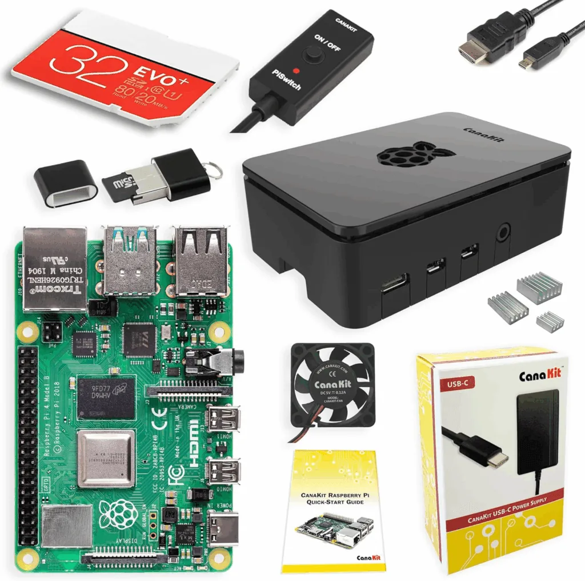
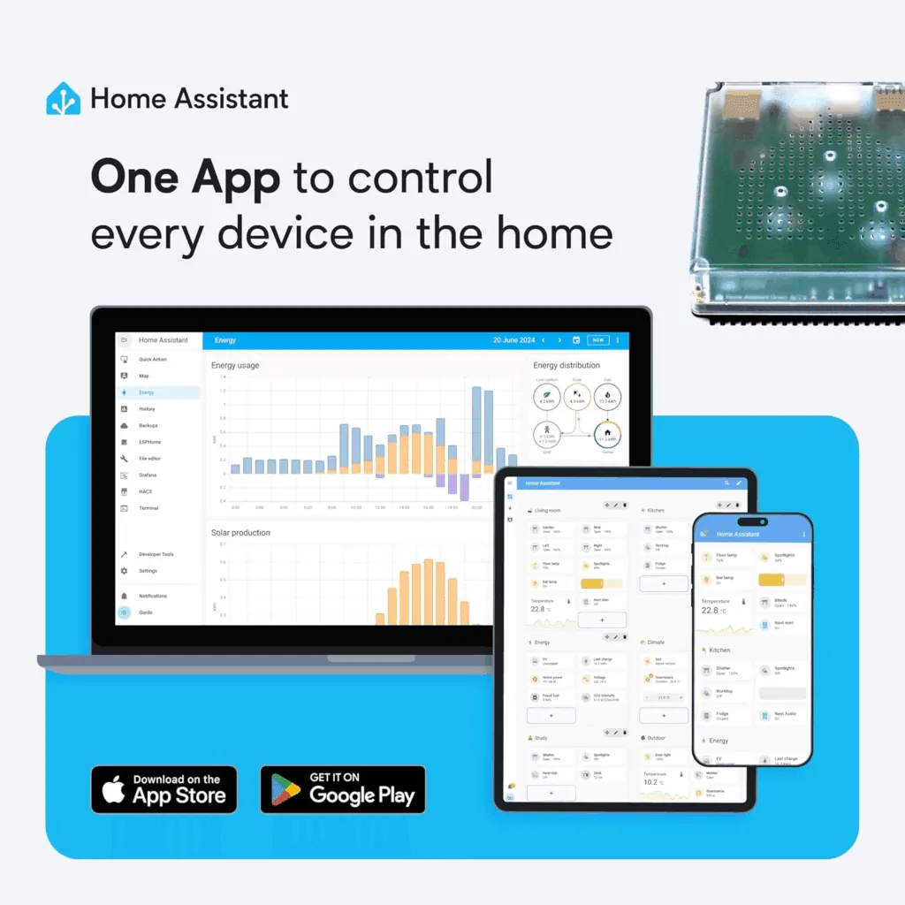
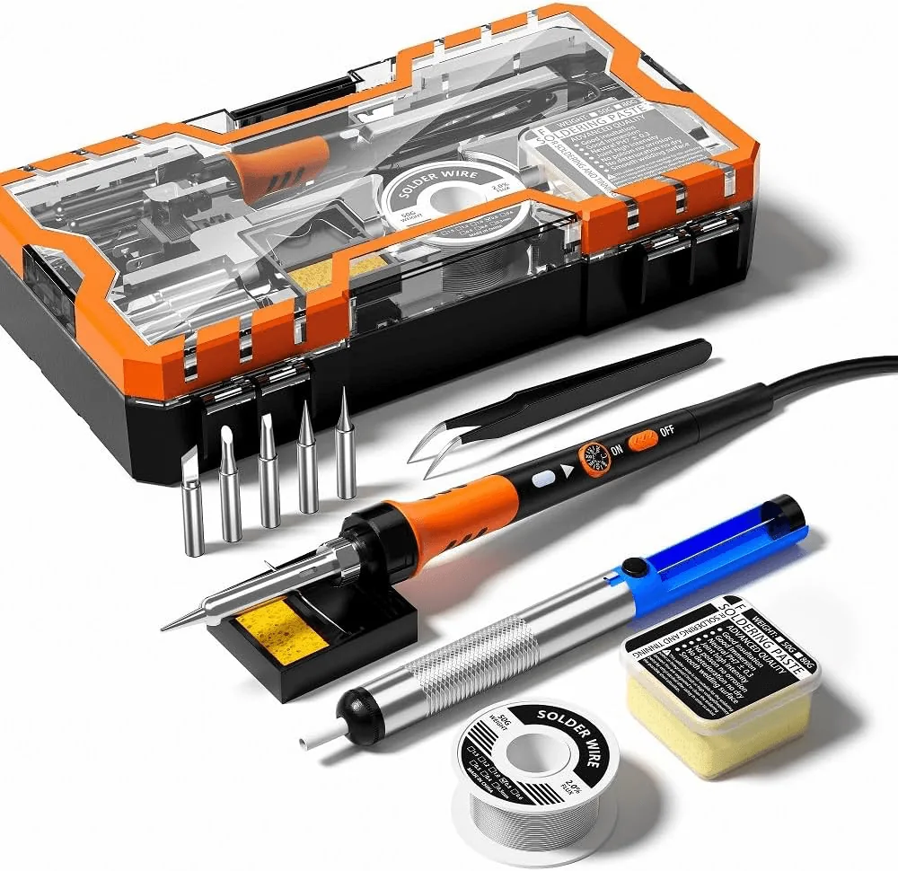
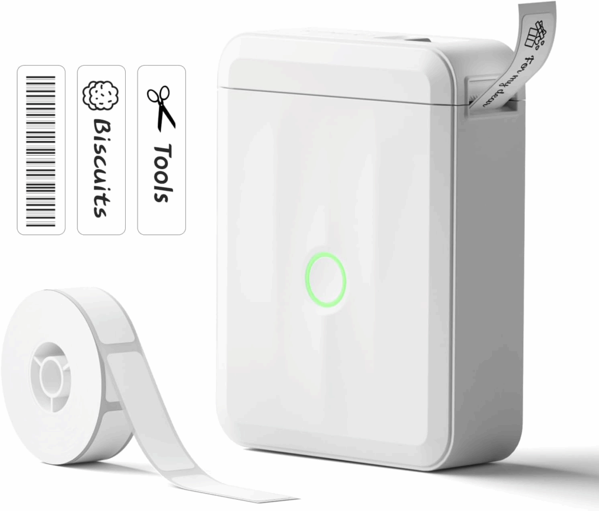
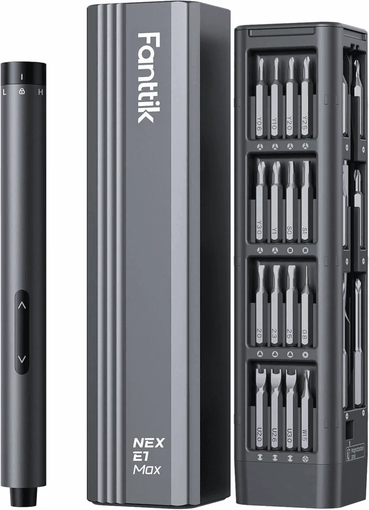

Father's Day 2025 is rapidly approaching so here are a few ideas to help you keep that geeky dad in your life happy!

Whether it is for a new dad, a dad-to-be or an old hand, these gifts will hopefully spark your inspiration and ensure they have a smile on their face come the 15th June.



## Raspberry Pi Starter Kit

Mid-life crisis hits people differently, but a new hobby is usually on the cards. If they are interested in tech and tinkering, then a Raspberry Pi will open a whole world of possibilities for them. From [Home Automation](/tags/home-automation/) to programming, robot building or just playing around with some LEDs anyone who likes to fidget and tinker will love this.

🔗 [https://amzn.to/4kRJKxI](https://amzn.to/4kRJKxI)

## Home Assistant Green

The Home Assistant / Nabu Case Green is a dedicated hardware device to run your Home Assistant software. As it is made by Nabu Casa, it is fully supported by them. It is one of the easiest and most reliable ways to get started on your Home Automation journey. I run my house on one of these and it hasn't missed a beat in over 9 months. It is what I connect my [DIY home energy monitoring](/diy-whole-home-energy-monitoring-with-home-assistant/) project to.

🔗 [https://amzn.to/4jEvSpJ](https://amzn.to/4jEvSpJ)

## Soldering Iron Kit

No self-respecting geek should be without a soldering kit in their home. Especially paired with the Raspberry Pi, soldering can be incredibly rewarding when you build your first circuit and control it from code that you wrote. Being able to fix faulty Christmas tree lights and other items around the home just makes having a kit like this all the more worthwhile.

🔗 [https://amzn.to/3TaplIq](https://amzn.to/3TaplIq)

## Mini Bluetooth Label Printer - BIG DISCOUNT!

Once you start amassing tinkering kit, you will end up with drawers and drawers of components and it soon gets hard to find things. And another critical component of a mid-life crisis is a sense of dread and overwhelm leading to a deep want to reorganise EVERYTHING. Labelling is your friend in this endeavour!

Plus this one is on a deep discount at the moment. Snap it up before it's too late!

🔗 [https://amzn.to/4dRyv69](https://amzn.to/4dRyv69)

## Precision motorised screwdriver

Once you get into tinkering a decent screwdriver set is an absolute necessity. You want a kit that has lots of tiny interchangeable heads and these kits also come with an electric screwdriver designed for working with very delicate screws found in electronics. Save your aging wrists and invest in one of these today. You won't regret it!

🔗 [https://amzn.to/4kMY36I](https://amzn.to/4kMY36I)
